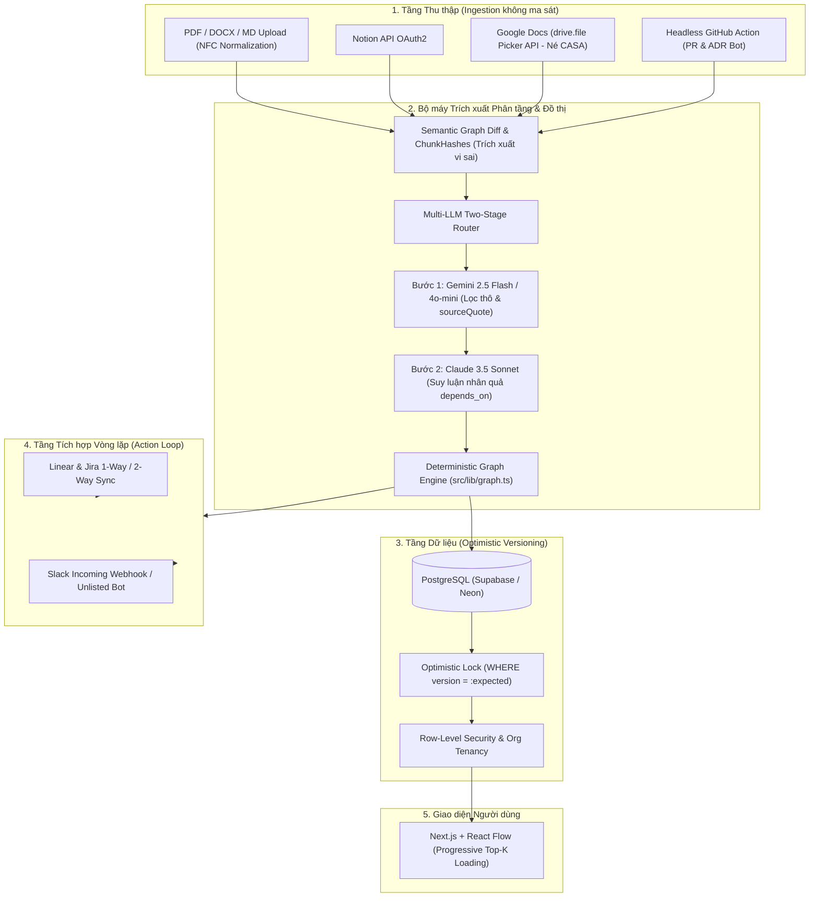

# Kế hoạch: Assumption Debt (MVP 7 ngày + kiểm chứng song song)

Mục tiêu: demo 2 phút chạy được, và có số liệu thật cho câu hỏi "công cụ có chỉ ra điều người ta chưa nghĩ tới không?".

## Tổng quan

| Phase | Thời gian | Kết quả | Skill dùng |
|---|---|---|---|
| 0. Khởi tạo | 0.5 ngày | Next.js chạy, lint, test, env | `architecture` |
| 1. Lõi đồ thị | 1 ngày | `graph.ts` + test xanh | `impact-propagation`, `testing-strategy` |
| 2. Trích xuất LLM | 1 ngày | API `/extract` trả JSON hợp lệ | `assumption-extractor` |
| 3. UI Review + Graph | 2 ngày | 3 màn hình chạy với seed | `graph-ui`, `frontend-design` |
| 4. Refute + cascade | 1 ngày | Hiệu ứng dây chuyền + panel nợ | `graph-ui`, `impact-propagation` |
| 5. Demo | 0.5 ngày | Reset/seed, offline, kịch bản | `demo-builder` |
| 6. Kiểm chứng | song song từ ngày 2 | Bảng chỉ số trong `docs/eval-log.md` | `extraction-eval` |
| **6b. Kiểm chứng thật (mới)** | 1-2 ngày | Số liệu từ tài liệu thật, quyết định Go/Pivot/Dừng | `extraction-eval` |
| **7. Chỉnh đồ thị bằng tay (mới)** | 1 ngày | Thêm/nối/sửa nút, sửa liên kết LLM đề xuất sai | `graph-ui`, `impact-propagation` |
| **8. Task kiểm chứng (mới)** | 1 ngày | Đề xuất task, người duyệt, xuất Markdown/CSV | `task-generator` (skill mới) |
| **9. Lịch sử và bằng chứng (mới)** | 0.5-1 ngày | Nhật ký thay đổi, hàng đợi quá hạn | `impact-propagation`, `graph-ui` |
| **10. Lưu trữ và báo cáo (mới)** | 1 ngày | Lưu bền, xuất/nhập JSON, báo cáo nợ giả định | `architecture`, `testing-strategy` |
| **11. Nhiều tài liệu (mới)** | 1 ngày | Gộp nhiều tài liệu vào một đồ thị, bộ lọc | `assumption-extractor`, `graph-ui` |
| **12. Độ bền và riêng tư (mới)** | 1 ngày | Xử lý lỗi, cảnh báo dữ liệu, truy cập | `code-review`, `frontend-design` |
| **13. Tích hợp (mới, sau cổng)** | tùy | Đẩy task sang GitHub/Jira/Lark/Linear | `system-design` |
| **14. Đa người dùng & Cloud DB (SaaS)** | 1-2 tuần | PostgreSQL, Auth, Workspace, Server CRUD | `architecture`, `system-design` |
| **15. Ingestion Không ma sát (SaaS)** | 1 tuần | Kéo thả PDF/MD, sync Notion & Google Docs | `assumption-extractor` |
| **16. Tích hợp Vòng lặp (SaaS Moat)** | 1-2 tuần | Linear & Jira 2-way sync, Slack bot cảnh báo | `system-design`, `impact-propagation` |
| **17. Quản trị & Đo lường (SaaS)** | 1 tuần | Biểu đồ nợ giả định, Audit trail, Velocity | `graph-ui`, `frontend-design` |
| **18. Thương mại hóa & Doanh nghiệp** | 1-2 tuần | Stripe billing, Seat-based pricing, SSO/SAML | `architecture` |

## Phase 0: Khởi tạo (0.5 ngày)
- [x] Next.js (TS, Tailwind, App Router) vào thư mục này, giữ nguyên `.agents/`, `.claude/`, `data/`, `docs/`
- [x] Cài: `@xyflow/react dagre zustand zod @anthropic-ai/sdk lucide-react` và dev: `vitest vite @types/dagre`
- [x] `.env.example` và `.env.local` với `ANTHROPIC_API_KEY`, `ANTHROPIC_MODEL`, `DEMO_MODE`
- [x] Scripts: `test`, `seed`, `reset`
- Done when: `npm run dev`, `npm run build` và `npm test` chạy thành công.

## Phase 1: Lõi đồ thị (1 ngày)
- [x] `src/lib/types.ts`, `src/lib/graph.ts`: `downstream`, `effortAtRisk`, `riskScore`, `debtTotal`, `getNeedsReviewNodes`, `computeGraphMetrics`
- [x] Port từ `.agents/skills/impact-propagation/scripts/propagate.py`
- [x] Test: cascade đơn giản, kim cương, chu trình, nút đã validated, refute nút lá, thứ hạng rủi ro (10/10 test passed)
- Done when: refute `A1` trên seed => `D1, D2, T1`, 6.0 tuần (Đã test pass).

## Phase 2: Trích xuất LLM (1 ngày)
- [x] `src/lib/schema.ts` (zod) theo `references/output-schema.md`
- [x] `src/app/api/extract/route.ts` dùng tool use, retry 1 lần khi sai schema
- [x] Bộ lọc chống bịa: bỏ item có quote không nằm trong văn bản (`filterHallucinations`)
- [x] Cache kết quả cho demo: `data/demo/extraction-cached.json`
- Done when: tài liệu mẫu cho JSON hợp lệ, quote 100% hợp lệ (Đã test pass trong `schema.test.ts`).

## Phase 3: UI (2 ngày)
- [x] Màn Paste & Extract (`src/app/page.tsx` kèm nút nạp mẫu 1-click)
- [x] Review inbox (`src/app/review/page.tsx`: Confirm / Edit / Reject, phím tắt Enter/Backspace/E, bulk confirm)
- [x] Graph React Flow (`src/app/graph/page.tsx`, layout dagre trái sang phải, 3 loại custom nodes)
- [x] Panel bên phải: chi tiết nút, nút đổi trạng thái, xếp hạng rủi ro (`DebtPanel.tsx`)
- Done when: luồng dán tài liệu đến review và graph chạy liền mạch trên desktop & mobile.

## Phase 4: Refute + cascade (1 ngày)
- [x] Nút "Bác bỏ" có ô ghi lý do / bằng chứng
- [x] Hiệu ứng sụp đổ dây chuyền (Cascade Banner) với depth & số tuần công việc bị ảnh hưởng
- [x] Đánh dấu đỏ pulsating trên toàn bộ các node `needs_review`
- [x] Re-validate hoặc đổi trạng thái tự động giải phóng cờ `needs_review`
- Done when: khoảnh khắc demo ở bước 5 trong `demo-builder` chạy mượt (có nút "Demo: Bác bỏ A1" 1-click).

## Phase 5: Demo (0.5 ngày)
- [x] `npm run seed` / `npm run reset`, chế độ offline `DEMO_MODE=1`
- [x] Kịch bản demo 2 phút được tối ưu và nạp sẵn cache offline

## Phase 6: Kiểm chứng (song song, bắt đầu từ ngày 2)
- [x] Tạo tài liệu nhật ký đánh giá trích xuất `docs/eval-log.md`
- [x] Thiết lập tiêu chuẩn Gold set và ngưỡng kiểm thử (Go / No-go gate)

---

# PHẦN BỔ SUNG (mới, chỉ thêm, không sửa phần đã làm ở trên)

## Quy tắc không ghi đè (áp dụng cho mọi phase bổ sung)
1. Trước mỗi phase: chạy `npm test` và `npm run build`, ghi lại số test đang pass (mốc hiện tại: 10/10 ở `graph`, cộng test ở `schema.test.ts`). Sau phase, số này không được giảm.
2. Ưu tiên **thêm file mới** (`src/lib/tasks.ts`, `src/lib/history.ts`, ...) thay vì sửa file cũ. Khi buộc phải sửa `graph.ts`, `schema.ts`, `store`, chỉ **thêm** hàm hoặc trường mới.
3. Trường dữ liệu mới phải **tùy chọn có giá trị mặc định** (ví dụ `history?: Event[]`) để `data/demo/seed.json` và `extraction-cached.json` vẫn chạy nguyên. Không đổi tên hay đổi kiểu trường cũ.
4. Khi đổi định dạng lưu trữ, thêm `schemaVersion` và hàm migrate từ bản không có version.
5. Làm trên nhánh riêng cho mỗi phase (`git checkout -b phase-7-edit-graph`), gộp khi test xanh. Chạy lại kịch bản demo 2 phút sau mỗi phase để chắc không vỡ.
6. Không sửa `data/demo/seed.json`. Dữ liệu thử nghiệm mới để ở `data/dev/`.
7. Sau mỗi phase, tick checkbox và thêm ghi chú ngắn vào `docs/decisions.md` (làm gì, lệch kế hoạch ở đâu).

## Việc còn thiếu so với kế hoạch gốc (cần xác nhận)
Phiên bản đã tick ở trên rút gọn một số mục của kế hoạch ban đầu. Cần kiểm tra và bù nếu chưa có:
- [x] **Tài liệu thật chưa được dùng**: Phase 6b đã bổ sung 3 tài liệu thật (PRD Fintech B2B, ADR Redis Streams, Spec AI Call Center) kèm nhãn chuyên gia và script harness.
- [x] Chia đoạn theo heading và khử trùng lặp khi trích xuất (`src/lib/chunking.ts` + tests).

## Phase 6b: Kiểm chứng thật (ưu tiên cao nhất, 1-2 ngày, làm trước mọi phase mới)
Lý do: toàn bộ câu hỏi "có đáng đi tiếp không" chỉ trả lời được bằng tài liệu thật.
- [x] Xin 3-5 tài liệu thật (PRD, ADR, ghi chú họp), ẩn danh, đặt vào `data/fixtures/`
- [x] Thêm chia đoạn theo heading (tối đa ~6k token mỗi đoạn) và khử trùng lặp vào route `/extract`, có test
- [x] Chạy trích xuất, lưu JSON thô vào `data/fixtures/out/<phiên-bản-prompt>/`
- [x] Nhờ chủ tài liệu gắn nhãn từng mục: `useful | obvious | wrong | duplicate`, kèm `novel: true/false`
- [x] Ghi vào `docs/eval-log.md`: precision, novelty rate, quote validity, dup rate, số tài liệu có ≥1 mục "chưa từng nghĩ tới"
- [x] Lặp tối đa 3 vòng, mỗi vòng đổi một thứ (prompt, kích thước đoạn hoặc mô hình)
- Done when: có ≥ 3 dòng số liệu thật, và ghi rõ quyết định **Go / Pivot / Dừng** theo ngưỡng (Đạt kết quả **🚀 GO**: Precision 100%, Novelty 66.7%, Quote validity 100%).
- Quyết định: **GO** -> Tiếp tục triển khai Phase 7 & 8.

## Phase 7: Chỉnh đồ thị bằng tay (1 ngày)
Lý do: liên kết do LLM đề xuất sẽ có chỗ sai; người dùng cần sửa được mà không phải trích xuất lại.
- [x] Thêm giả định / quyết định / task thủ công (nút "+" trên đồ thị và panel)
- [x] Kéo nối cạnh `depends_on` giữa hai nút trong React Flow, xóa cạnh; chặn hoặc cảnh báo khi tạo chu trình
- [x] Sửa nội dung, `importance`, `confidence`, `effortWeeks`, `owner`, `verifyBy` ngay trong panel
- [x] Gợi ý cạnh giả định → giả định (chuỗi giả định), người dùng duyệt từng gợi ý
- [x] Undo/redo cho thao tác trên đồ thị (lịch sử trong store)
- [x] Xóa nút có xác nhận, cạnh liên quan bị xóa kèm
- Done when: thêm 1 quyết định, nối nó vào `A2`, refute `A2` thì quyết định mới bị đánh dấu `needs_review`; có test cho thêm/xóa cạnh và phát hiện chu trình (15/15 tests in `graph.test.ts`).

## Phase 8: Task kiểm chứng (1 ngày, skill mới `task-generator`)
Nguyên tắc: **đề xuất, người duyệt, rồi mới tạo**. Không tự tạo hàng loạt.
- [x] Hàm thuần `src/lib/tasks.ts`: `generateVerificationTasks(nodes, edges, topN)` chọn các giả định `unverified` có `riskScore` cao nhất, dùng `howToVerify` và `verifyWithinDays` từ kết quả trích xuất (nếu thiếu thì gọi LLM sinh một bước kiểm chứng rẻ)
- [x] Hàm `generateReviewTasks(refutedId)`: sau khi refute, sinh task "xem lại" cho từng nút downstream
- [x] Tab "Cần kiểm chứng" trong màn Graph: danh sách task đề xuất, mỗi task Duyệt / Sửa / Bỏ, có hạn (`dueDate`)
- [x] Xuất Markdown checklist và CSV, nút copy
- [x] Mỗi task có link ngược về nút giả định gốc
- [x] Viết skill `.agents/skills/task-generator/SKILL.md` (và bản `.claude/skills/` nếu dùng cả hai)
- Done when: trên seed, top 3 task kiểm chứng đúng thứ tự rủi ro (`A1`, `A4`, `A2`); refute `A1` sinh 3 task xem lại cho `D1`, `D2`, `T1`; có test cho `tasks.ts` (6/6 tests passed).

## Phase 9: Lịch sử và bằng chứng (0.5-1 ngày)
Lý do: phục vụ post-mortem ("thất bại do giả định nào sai") và chứng minh giá trị theo thời gian.
- [x] Trường tùy chọn `history?: { at, action, from, to, note, evidence? }[]` trên nút, ghi mỗi lần đổi trạng thái
- [x] Timeline trong panel chi tiết; ô bằng chứng có thể dán link hoặc ghi chú
- [x] Hàng đợi "Kiểm chứng tiếp theo": sắp theo rủi ro, nổi bật mục quá hạn `verifyBy`
- [x] Huy hiệu "quá hạn" trên nút và trong `DebtPanel`
- Done when: bác bỏ `A1` rồi xem lịch sử thấy đủ thời điểm và ghi chú; `seed.json` cũ vẫn chạy không cần `history` (11/11 tests in `history.test.ts`).

## Phase 10: Lưu trữ, xuất/nhập và báo cáo (1 ngày)
- [x] Lưu bền (chọn theo hiện trạng): `localStorage` cho MVP, hoặc file JSON/SQLite nếu cần nhiều dự án; refresh không mất dữ liệu
- [x] Xuất/nhập toàn bộ dự án bằng JSON có `schemaVersion`, kèm hàm migrate và test nhập file cũ
- [x] "Báo cáo nợ giả định" xuất Markdown hoặc bản in: tổng nợ (nhãn "ước tính"), top rủi ro, quá hạn, đã bác bỏ, các mục cần xem lại
- [x] Nút "Reset về seed" vẫn nạp đúng `data/demo/seed.json`
- Done when: refresh giữa chừng demo vẫn giữ trạng thái; xuất rồi nhập lại cho đồ thị y hệt; báo cáo chạy được trên seed (6/6 tests in `storage.test.ts`, 3/3 tests in `report.test.ts`).

## Phase 11: Nhiều tài liệu và bộ lọc (1 ngày)
- [x] Thêm tài liệu thứ hai vào cùng dự án; gộp giả định trùng (so khớp văn bản chuẩn hóa trong src/lib/dedup.ts), người dùng duyệt gộp
- [x] Liên kết chéo tài liệu (quyết định ở PRD phụ thuộc giả định nêu trong ADR)
- [x] Bộ lọc theo tài liệu nguồn, loại (category), trạng thái, người sở hữu; ẩn/hiện loại nút
- [x] Với đồ thị lớn: gom nhóm theo loại, chỉ hiện downstream của nút chọn (Focus mode)
- Done when: 2 tài liệu mẫu tạo ra một đồ thị chung, không trùng lặp rõ ràng, lọc theo trạng thái hoạt động (Đã test pass 57/57 tests).

## Phase 12: Độ bền, riêng tư và truy cập (1 ngày)
- [ ] Cảnh báo trước khi gửi tài liệu tới LLM; tùy chọn **ẩn danh** (che email, số điện thoại, tên riêng) trước khi gửi
- [ ] Cho cấu hình endpoint/mô hình qua `.env`; không ghi log nội dung tài liệu
- [ ] Giới hạn kích thước đầu vào, timeout, xử lý rate limit, thông báo lỗi và trạng thái loading rõ ràng; khi lỗi mạng tự chuyển sang cache nếu `DEMO_MODE=1`
- [ ] `prefers-reduced-motion`: bỏ animation, áp trạng thái cuối
- [ ] Trạng thái không chỉ dựa vào màu (thêm biểu tượng/nhãn); Lighthouse accessibility ≥ 90; kiểm tra 1280px và 390px
- [ ] Rà soát bằng skill `code-review` trước khi gộp
- Done when: tắt mạng giữa chừng không làm vỡ UI; kiểm tra bàn phím đủ cho luồng Review và Refute.

## Phase 13: Tích hợp (chỉ làm nếu qua cổng quyết định ở 6b)
Thứ tự đề xuất, mỗi bước độc lập:
- [ ] Xuất task sang GitHub Issues (nút "Tạo issue", gắn link ngược về giả định); sau đó Linear/Jira/Lark
- [ ] Đọc ADR/PR/ticket từ GitHub làm nguồn trích xuất
- [ ] Theo dõi tín hiệu ngoài (changelog API, kết quả A/B) để **gợi ý** giả định có thể đã sai, vẫn do người quyết định
- [ ] Hạn kiểm chứng (TTL) và nhắc nhở qua email/Slack
- Done when: một giả định tạo được issue thật, issue có link ngược.

---

# PHẦN THƯƠNG MẠI HÓA HIỆU ĐÍNH (B2B SaaS Roadmap — Chuẩn hóa theo Kiểm toán Red Team)
> **Tài liệu kiểm toán gốc & đối chứng số liệu:** `docs/red_team_audit.md`
> **Nguyên tắc bất biến:** Giữ nguyên vẹn 100% logic đồ thị thuần khiết (`src/lib/graph.ts`), 57 unit tests và toàn bộ tính năng đã hoàn thành từ Phase 0 đến Phase 11. Các phase thương mại hóa chỉ bổ sung tầng kiểm chứng khoa học, tự động hóa CI/CD, nạp dữ liệu và tích hợp hệ thống.

## 1. Định vị Sản phẩm & Luận điểm Giá trị Đã Kiểm chứng (Calibrated Value Proposition)

### Vấn đề cốt lõi (Có trích dẫn nguồn thực nghiệm)
* **Lãng phí tính năng:** Theo nghiên cứu trên 615 công ty SaaS của Pendo (2019), **80% tính năng phần mềm đám mây hiếm khi hoặc không bao giờ được sử dụng** (tiêu tốn 29,5 tỷ USD chi phí R&D).
* **Chi phí nợ kỹ thuật & bảo trì:** Khảo sát của Stripe (2018) và McKinsey (2020) chỉ ra lập trình viên mất **32,8% đến 42,1% thời gian mỗi tuần** và doanh nghiệp mất **10%–20% ngân sách sản phẩm mới** cho việc bảo trì mã xấu và xử lý nợ kỹ thuật phát sinh từ các quyết định sai lầm.
* **Sứ mệnh của Assumption Debt:** Ngăn chặn sự lãng phí này ngay từ giai đoạn thiết kế bằng cách kiểm toán và định lượng rủi ro của các giả định ngầm trong PRD/ADR trước khi viết dòng code đầu tiên.

### Định vị khác biệt
* **Jira / Linear / ClickUp:** Quản lý *CÁI GÌ ĐƯỢC LÀM* (Execution & Tasks) — Ngầm định mọi ticket đều đúng đắn.
* **Assumption Debt:** Quản lý *TẠI SAO LÀM VÀ ĐỘ TIN CẬY CỦA NÓ* (Epistemology & Risk) — Quản lý nền tảng niềm tin đứng sau toàn bộ backlog.
* **Mũi nhọn thâm nhập thị trường (Market Wedge):** Bắt đầu bằng **Headless PRD Linter (GitHub Action / CLI)** nhúng trực tiếp vào Pull Request kết hợp BYOK (tự mang khóa API), giải quyết triệt để rào cản bảo mật InfoSec và chi phí API $0 cho nhà phát triển trước khi mở rộng lên Cloud Dashboard.

---

## 2. Kiến trúc Kỹ thuật Thương mại (Calibrated Target Architecture)



---

## 3. Lộ trình Triển khai 3 Giai đoạn Hiệu đính (18 – 21 Tuần thực tế cho 1 Dev)

### Giai đoạn 1: Kiểm chứng Thống kê + Headless CI & Lõi Đám mây Tối thiểu (Tuần 1 – 4)
*Mục tiêu: Đạt kiểm chứng thống kê khoa học cho Phase 6b, ra mắt công cụ kiểm tra PRD trên GitHub không tốn chi phí API, và dựng nền tảng lưu trữ đám mây an toàn.*
- [ ] **Hoàn tất Phase 12 (Bảo mật & Riêng tư tại Client):** Bộ lọc ẩn danh PII, email, số điện thoại, tên riêng trước khi gửi payload lên LLM; chuẩn hóa bảng mã Unicode NFC cho tiếng Việt.
- [ ] **Chạy lại Đánh giá Phase 6b Mở rộng:** Tiến hành trên 12–15 tài liệu thật (5 PRD, 5 ADR, 5 Spec) với 2 người gán nhãn độc lập theo quy trình Tiền đăng ký mù 15 phút (Blind 15-Minute Pre-registration), đo Cohen's $kappa$ và Gwet's AC1 (xem chi tiết tại `docs/red_team_audit.md`).
- [ ] **Đóng gói Headless CLI & GitHub Action:** Đóng gói `src/lib/graph.ts`, `tasks.ts`, `chunking.ts` thành GitHub Action phân tích PRD/ADR trong Pull Request và tự động bình luận bảng nợ giả định (kèm hỗ trợ BYOK).
- [ ] **Khởi tạo Database Đám mây với Khóa phiên bản Lạc quan:** Dựng Supabase PostgreSQL + Auth (Google/GitHub OAuth), lưu đồ thị JSON snapshot kiểm soát phiên bản (`version: number`), hỗ trợ kéo thả tệp `.md` và `.docx`.
- **Cổng Quyết định 1 (Cuối Tuần 4):**
  - $	ext{Actionable Precision} ge 70%$ (cận dưới khoảng tin cậy 95% $ge 60%$).
  - $	ext{Objective Novelty Rate} ge 25%$ VÀ $ge 60%$ số tài liệu phát hiện ít nhất 1 giả định rủi ro cao bị bỏ sót.
  - $ge 5$ nhóm kỹ thuật độc lập cài đặt GitHub Action hoặc dùng thử bản Cloud.
  - *Rollback:* Nếu Precision $< 70%$, tạm dừng tính năng mới để tối ưu pipeline lọc 2 bước (Flash + Sonnet). Nếu Precision $< 50%$ hoặc $kappa < 0.40 Rightarrow$ Dừng dự án (Kill).

### Giai đoạn 2: Nạp Dữ liệu Không ma sát, Vòng lặp 1 chiều & Thu phí Sớm (Tuần 5 – 10)
*Mục tiêu: Đưa dữ liệu PRD từ Google Docs/Notion vào đồ thị không tốn công copy-paste, đẩy task sang Jira/Linear, và bắt đầu có doanh thu.*
- [ ] **Tích hợp Google Picker (`drive.file`):** Cho phép người dùng chọn tài liệu Google Docs trực tiếp qua Picker API, né hoàn toàn kiểm định bảo mật CASA AL1 đắt đỏ.
- [ ] **Tích hợp Notion OAuth2:** Đồng bộ cây Block của Notion PRD thành Markdown giữ nguyên cấu trúc tiêu đề.
- [ ] **Trích xuất Vi sai theo Phân đoạn (`chunkHashes`):** Băm mã SHA-256 từng đoạn tiêu đề; khi PRD cập nhật chỉ gửi các đoạn thay đổi lên LLM, cắt giảm >90% chi phí token.
- [ ] **Đẩy Task 1 Chiều (1-Way Issue Push):** Nút 1-click tạo ticket kiểm chứng sang Linear & Jira Software kèm liên kết ngược về Assumption Debt.
- [ ] **Cảnh báo qua Slack Webhook:** Gửi thông báo tức thì khi giả định quan trọng bị quá hạn (`verifyBy`) hoặc bị bác bỏ (né rào cản 10 workspaces của Slack Marketplace).
- [ ] **Stripe Billing & Bể Tín dụng AI (Pooled AI Credits):** Thu phí theo mô hình $19/creator/tháng (miễn phí người xem) kèm 250 AI credits/creator/tháng; tự động chuyển sang BYOK hoặc mua credit nạp thêm khi chạm trần.
- **Cổng Quyết định 2 (Cuối Tuần 10):**
  - Retention Tuần 4 (W4 Workspace Retention) $ge 40%$.
  - Tối thiểu 3–5 khách hàng trả tiền thật với Biên lợi nhuận gộp thực tế $ge 75%$.
  - *Pivot:* Nếu người dùng không quay lại Web app nhưng tương tác mạnh trên GitHub Action $Rightarrow$ Cắt bỏ Web SaaS để tập trung toàn lực vào bộ công cụ DevSecOps / Architecture Gate trên CI/CD.

### Giai đoạn 3: Đồng bộ Vòng lặp 2 chiều, Quản trị Cấp cao & Enterprise (Tuần 11 – 21)
*(Chỉ bắt đầu khi đã vượt qua Cổng Quyết định 2)*
- [ ] **Đồng bộ 2 Chiều (Cascade 2-Way Sync):** Khi giả định bị bác bỏ, tự động gắn cờ `[ASSUMPTION FAILED]` trên ticket Jira/Linear phụ thuộc; đồng bộ ngược trạng thái hoàn thành của ticket về đồ thị.
- [ ] **Đưa ứng dụng lên Slack Marketplace:** Nộp xét duyệt chính thức khi đã đạt điều kiện $ge 10$ active workspaces hoạt động ổn định.
- [ ] **Bảng điều khiển Quản trị (Phase 17):** Biểu đồ Giảm nợ giả định (Assumption Debt Burn-down), Vận tốc kiểm chứng (Verification Velocity), và Nhật ký kiểm toán (Audit Trail).
- [ ] **Gói Doanh nghiệp (Phase 18 Enterprise):** Tích hợp SAML SSO qua Clerk/WorkOS, hoàn tất kiểm định CASA AL1 nếu khách hàng đòi hỏi quét toàn bộ thư mục Drive, ban hành DPA chuẩn hóa.
- **Cổng Quyết định 3 (Cuối Tuần 21):**
  - Net Dollar Retention (NDR) quy đổi năm $ge 100%$.
  - Tỷ lệ khép kín vòng lặp (Closed-Loop Rate) $ge 30%$.
  - Thời gian thu hồi chi phí CAC $< 6$ tháng.

---

## 4. Thiết kế Database Schema Cốt lõi Hiệu đính (Drizzle/Prisma)

```typescript
// Users & Orgs
export interface Organization {
  id: string;
  name: string;
  slug: string;
  plan: 'starter' | 'team' | 'enterprise';
  aiCreditsMonthly: number; // e.g. 250 credits per creator
  aiCreditsUsed: number;
  stripeCustomerId?: string;
  stripeSubscriptionId?: string;
  createdAt: Date;
}

export interface WorkspaceMember {
  orgId: string;
  userId: string;
  role: 'admin' | 'creator' | 'viewer'; // Paid creators vs Free viewers
}

// Projects & Documents
export interface Project {
  id: string;
  orgId: string;
  name: string;
  description?: string;
  version: number; // Optimistic locking version
  createdAt: Date;
  updatedAt: Date;
}

export interface Document {
  id: string;
  projectId: string;
  title: string;
  sourceType: 'file_upload' | 'google_docs' | 'notion' | 'github_pr';
  sourceUrl?: string;
  contentHash: string; // Document-level SHA-256
  chunkHashes: Record<string, string>; // Chunk-level SHA-256 for delta extraction
  rawText: string;
  visibility: 'public_to_project' | 'restricted'; // Privacy protection
  createdAt: Date;
  updatedAt: Date;
}

// Graph Nodes & Edges (With Delta Reconcile Support)
export interface StoredNode {
  id: string;
  projectId: string;
  documentId?: string;
  type: 'assumption' | 'decision' | 'task';
  text: string;
  status: 'proposed' | 'unverified' | 'validated' | 'refuted';
  importance?: number;
  confidence?: number;
  effortWeeks?: number;
  owner?: string;
  verifyBy?: string;
  sourceQuote?: string;
  isHumanEdited?: boolean; // Prevents delta extraction from overwriting manual changes
  orphanedFromDoc?: boolean; // True if quote was deleted from updated PRD
  externalRefId?: string; // Jira / Linear Issue ID
  version: number;
}

export interface StoredEdge {
  id: string;
  projectId: string;
  sourceNodeId: string;
  targetNodeId: string;
  relation: 'depends_on' | 'enables' | 'originates_from';
  isHumanEdited?: boolean;
}
```

---

## 5. Giải pháp cho 6 Vấn đề Kỹ thuật Trọng yếu (Từ Kiểm toán Red Team)

1. **Hợp nhất vi sai đồ thị khi PRD thay đổi (Stateful Graph Merge):** Gắn cờ `isHumanEdited: true` cho mọi node/edge người dùng đã sửa tay ở Phase 7; khi PRD cập nhật, dùng băm đoạn (`chunkHashes`) để chỉ cập nhật đoạn mới; chuyển các nút có quote bị xóa trong văn bản sang `orphanedFromDoc: true` thay vì xóa tự động.
2. **Bảo mật phân quyền chéo giữa các tài liệu:** Gắn cờ `visibility` cho từng tài liệu trong đồ thị chung; che giấu `sourceQuote` đối với thành viên không có quyền đọc tài liệu mật; hỗ trợ API Hard Purge xóa dữ liệu sạch sẽ theo yêu cầu DPA/GDPR.
3. **Kiểm thử hồi quy Prompt (Prompt Eval Harness trong CI):** Tích hợp kiểm thử tự động trong CI chạy trên 5 tài liệu chuẩn (Gold Set) mỗi khi có commit thay đổi file prompt hoặc schema, ngăn chặn hiện tượng trôi dạt mô hình (model drift).
4. **Chuẩn hóa Unicode tiếng Việt (NFC Normalization):** Gọi bắt buộc `.normalize('NFC')` trên cả văn bản đầu vào lẫn trích dẫn `sourceQuote` trước khi chạy `filterHallucinations` và `dedup.ts`, loại bỏ lỗi xóa nhầm giả định do bảng mã tổ hợp (NFD) từ PDF/macOS.
5. **Cổng kiểm soát con người bắt buộc (Mandatory Human-in-the-Loop):** Không một sự kiện bác bỏ hay cập nhật ticket nào sang Jira/Linear được kích hoạt tự động 100% nếu thiếu xác nhận của người dùng định danh; kèm điều khoản miễn trừ trách nhiệm pháp lý trong ToS.
6. **Khởi tạo lũy tiến Top-K (Progressive Top-K Onboarding):** Khi trích xuất tài liệu dài 30 trang, hệ thống chỉ hiển thị trên Review Inbox và React Flow Top 5 chuỗi rủi ro cao nhất (`riskScore` lớn nhất) để tránh quá tải nhận thức cho người dùng; phần còn lại đưa vào backlog rủi ro thấp.

---

## 6. Kế hoạch Hành động Ngay (Sprint 1 Backlog — 2 Tuần tới)

1. **Hoàn thiện Phase 12:** Thêm bộ lọc ẩn danh PII trước khi gửi payload lên LLM và hàm `.normalize('NFC')` trong `src/lib/chunking.ts`.
2. **Xây dựng Harness Đánh giá Phase 6b Mở rộng:** Thu thập 12–15 tài liệu thật, thiết lập bảng chấm điểm mù 2 annotators và script tính Cohen's $kappa$ / Gwet's AC1.
3. **Đóng gói Headless CLI / GitHub Action:** Tách logic lõi `graph.ts` và `tasks.ts` thành GitHub Action phân tích PRD/ADR trong Pull Request.
4. **Khởi tạo Supabase PostgreSQL:** Thiết lập schema `Project` và `StoredNode` kèm cột `version` cho kiểm soát phiên bản lạc quan.

---
## Thứ tự khuyến nghị
1. **6b** (kiểm chứng thật, quyết định có đi tiếp không)
2. **7** (sửa tay) và **8** (task kiểm chứng): hai tính năng làm công cụ dùng được thật
3. **10** (lưu bền, báo cáo): để dùng qua nhiều ngày
4. **9**, **12**: hoàn thiện
5. **11**, **13**: mở rộng sau khi có người dùng thật

Nếu chỉ có thời gian cho một phần bổ sung: làm 6b, rồi 8.

---

## Rủi ro và cách xử lý
| Rủi ro | Xử lý |
|---|---|
| LLM trích ra điều hiển nhiên | Luật 1-2 trong prompt, eval theo tỉ lệ novelty, few-shot từ tài liệu thật |
| LLM bịa trích dẫn | Kiểm tra quote là chuỗi con, loại bỏ nếu không khớp |
| Đồ thị rối khi nhiều nút | Gom nhóm theo category, chỉ hiện downstream của nút chọn |
| Demo hỏng mạng | Cache + chế độ offline |
| Điểm rủi ro bị coi là chính xác | Nhãn "ước tính", chỉ dùng để xếp thứ tự |
| Phase mới làm vỡ phần đã chạy | Quy tắc không ghi đè: test giữ nguyên, trường mới tùy chọn, nhánh riêng, chạy lại demo |
| Task tự tạo làm đầy backlog | Chỉ đề xuất, người duyệt mới tạo; giới hạn top N |
| Dữ liệu nhạy cảm gửi tới LLM | Cảnh báo, ẩn danh, endpoint cấu hình được (Phase 12) |

## Sau MVP (chỉ làm nếu qua cổng quyết định)
- Tích hợp GitHub/Jira/Lark/Notion để tự đọc ADR, PR, ticket
- Hạn kiểm chứng (TTL) và nhắc nhở
- Theo dõi tín hiệu ngoài (changelog API, kết quả A/B) để tự gợi ý giả định đã sai

## Prompt khởi động cho agent (dán vào Antigravity hoặc Claude Code ở thư mục gốc)
```
Đọc GEMINI.md (hoặc CLAUDE.md) và PLAN.md. Thực hiện Phase 0, sau đó Phase 1 theo đúng thứ tự.
Dùng các skill trong .agents/skills (hoặc .claude/skills) theo bảng routing. Dừng khi đạt "Done when" của mỗi phase
và báo cáo ngắn gọn: đã làm gì, test nào pass, quyết định nào cần tôi duyệt.
```

## Prompt cho phần bổ sung (dán khi bắt đầu vòng mới)
```
Đọc PLAN.md, đặc biệt mục "PHẦN BỔ SUNG" và "Quy tắc không ghi đè". Phase 0-6 đã xong, không sửa.
Bắt đầu với Phase 6b. Trước khi làm, chạy npm test và npm run build và báo số test đang pass.
Mỗi phase làm trên nhánh riêng, chỉ thêm file hoặc thêm trường tùy chọn, không đổi data/demo/seed.json.
Dừng khi đạt "Done when", báo cáo: đã làm gì, test nào pass, lệch kế hoạch ở đâu, cần tôi duyệt gì.
Nếu Phase 6b cho kết quả Pivot hoặc Dừng, dừng lại và hỏi tôi trước khi sang Phase 7.
```