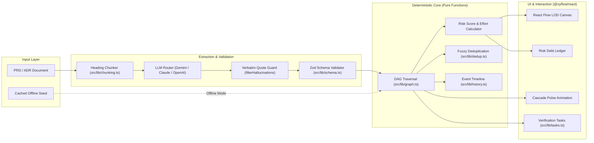

<div align="center">

# ▲ Assumption Debt

**The Epistemic Risk Engine for Product & Engineering Teams**

*Extract implicit assumptions from PRDs and ADRs, map downstream dependency graphs, and compute engineering blast radiuses before writing a single line of code.*

<br />

[](https://nextjs.org/)
[](https://react.dev/)
[](https://www.typescriptlang.org/)
[](https://reactflow.dev/)
[](https://vitest.dev/)
[](https://opensource.org/licenses/MIT)

<br />

[Live Demo](#quickstart) • [Core Philosophy](#core-philosophy) • [Key Features](#key-features) • [Architecture](#architecture) • [Roadmap](#roadmap) • [Documentation](docs/)

<br />

</div>

---

## 📌 The Problem

> *"80% of features in the average cloud software product are rarely or never used, resulting in over $29.5B of wasted R&D capital."*  
> — **Pendo 2019 Feature Adoption Report** (analyzing product telemetry across 615 SaaS platforms)
>
> *"Engineering teams spend 32.8% to 42.1% of their weekly capacity resolving technical debt, debugging, and maintaining bad code originating from flawed initial assumptions."*  
> — **Stripe Developer Coefficient (2018) & McKinsey (2020)**

| Execution Trackers (Jira / Linear / ClickUp) | Hypothesis Risk Engine (**Assumption Debt**) |
| :--- | :--- |
| Focuses on **WHAT** gets built (Tasks, Sprints, Epics). | Focuses on **WHY** it's being built and how fragile the foundation is. |
| Assumes every ticket in the backlog is inherently correct. | Treats every document as a cluster of **untested assumptions**. |
| Dead assumptions linger in tickets until launch failure. | Refuting an assumption **instantly highlights every affected decision in red**. |

---

## ✨ Key Features

### 🔍 1. Verbatim-Enforced Extraction (Zero Hallucination)
- **Quote-Backed Hypotheses:** Every extracted assumption must include an exact, character-for-character `sourceQuote` from the document.
- **Strict Hallucination Filter:** Any hypothesis whose quote cannot be strictly located in the source text is instantly discarded.
- **Multi-LLM Native Support:** Switch seamlessly between **Google Gemini 2.5 Flash**, **Anthropic Claude 3.5 Sonnet**, and **OpenAI GPT-4o**.

### 🕸️ 2. Deterministic Directed Acyclic Graph (DAG)
- **Pure Functional Logic:** All graph reachability algorithms (downstream BFS/DFS, cycle detection, risk propagation) reside in pure TypeScript functions (`src/lib/graph.ts`).
- **Mathematically Verifiable:** No AI hallucinations in graph traversal. If $A_1 \rightarrow D_1 \rightarrow T_1$, refuting $A_1$ mathematically marks $D_1$ and $T_1$ as `needs_review`.
- **Topological Layout:** Powered by `dagre` with wide-canvas auto-spacing (`ranksep: 220px`, `nodesep: 64px`) optimized for 16:9 engineering displays.

### 💥 3. One-Click Refutation & Cascade Blast Radius
- **Instant Risk Propagation:** Click **"Bác bỏ" (Refute)** on any assumption to trigger an animated cascade.
- **Effort at Risk Counter:** Dynamically calculates total engineering weeks jeopardized (e.g., *"18.0 weeks at risk"*).
- **Root-Cause Post-Mortem:** Track every status transition, timestamp, and refutation rationale in the node's timeline inspector.

### 📐 4. Semantic Zoom (Level of Detail - LOD) & Obsidian UI
- **Adaptive Canvas Dots:** Custom inverse-scaling background ensures dot grids remain sharp and never fade into pitch black when zooming out.
- **Semantic Card LOD:** Zooming out (`zoom < 0.68`) automatically hides secondary quotes and text clutter, rendering bold macro-cards with glowing status pills.
- **Vercel-Inspired Obsidian Design:** Built with high-contrast `#141417` obsidian surfaces, top accent identity borders, and glowing alerts.

### 🗂️ 5. Multi-Document Consolidation & Fuzzy Deduplication
- **Unified Risk Map:** Ingest multiple documents (PRDs, ADRs, Technical Specs) into a single connected graph.
- **Fuzzy Duplicate Detection:** Algorithms in `src/lib/dedup.ts` identify overlapping claims across different team documents and provide a 1-click merge workflow.
- **Smart Filter Bar:** Filter graph views by document origin, node type, verification status, and category.

### 📋 6. Human-in-the-Loop Task Generator
- **Actionable Verification Tasks:** Automatically derives verification tasks from the highest-risk unverified assumptions.
- **Review Checklists:** Generates post-refutation audit tasks for affected engineers.
- **Standardized Export:** 1-click export to Markdown checklist format or RFC-4180 compliant CSV.

---

## 🏗️ Architecture



---

## ⚡ Quickstart

### Prerequisites
- Node.js `18.x` or higher
- npm / pnpm / yarn

### 1. Clone & Install
```bash
git clone https://github.com/your-username/assumption-debt.git
cd assumption-debt
npm install
```

### 2. Configure Environment
Create a `.env.local` file in the root directory:
```env
# Optional: LLM API Keys (Default demo works 100% offline without any API keys)
GEMINI_API_KEY=your_gemini_api_key_here
ANTHROPIC_API_KEY=your_anthropic_api_key_here
OPENAI_API_KEY=your_openai_api_key_here

# Offline Demo Mode (1 = enable cached fallback)
DEMO_MODE=1
```

### 3. Run Development Server
```bash
npm run dev
```
Open [http://localhost:3000](http://localhost:3000) in your browser.

### 4. Run Test Suite
```bash
npm test
```
All **57 unit tests** across 8 test suites run in under 1 second:
```text
 ✓ src/lib/chunking.test.ts (6 tests)
 ✓ src/lib/storage.test.ts (6 tests)
 ✓ src/lib/history.test.ts (11 tests)
 ✓ src/lib/graph.test.ts (15 tests)
 ✓ src/lib/tasks.test.ts (6 tests)
 ✓ src/lib/report.test.ts (3 tests)
 ✓ src/lib/schema.test.ts (6 tests)
 ✓ src/lib/dedup.test.ts (4 tests)

 Test Files  8 passed (8)
      Tests  57 passed (57)
```

---

## 🎯 2-Minute Demo Script (Hackathon / Pitch Ready)

The repository comes pre-loaded with an offline-ready scenario (*Instant Merchant Advance B2B Fintech PRD*):

1. **Step 1: Inspect Seed Graph**  
   Open `/graph`. See 4 assumptions, 4 decisions, and 4 tasks connected via an expansive DAG. Total Estimated Debt: **8.6 points (~18.0 weeks at risk)**.
2. **Step 2: The Refutation Shock**  
   Click the prominent red button **`Demo: Bác bỏ A1`** on the top toolbar.
3. **Step 3: The Cascade Effect**  
   Watch the graph light up: $A_1$ flashes crimson, while downstream decisions $D_1, D_2$ and engineering task $T_1$ trigger pulsating red rings marked with `⚠️ Cần xem lại` (Needs Review).
4. **Step 4: Audit & Export Tasks**  
   Switch to the **Tasks** tab in the sidebar. Notice 3 newly generated review tasks. Click **"Xuất Markdown"** to copy a post-mortem review checklist ready for Jira/GitHub.
5. **Step 5: Instant Reset**  
   Click **`Reset Demo`** to restore the seed state in milliseconds.

---

## 🛡️ Core Philosophy & Non-Negotiables

1. **The Human Decides; The LLM Proposes:** Extracted items are marked as `proposed` until explicitly approved or verified by an engineer or product manager.
2. **Strict Verbatim Quotes:** No synthetic hallucinations. If an assumption cannot be traced back to an exact sentence in the PRD, it is dropped.
3. **Deterministic Graph Logic:** Graph mathematics (BFS, cycle detection, transitive reduction) must never run inside prompt completions. They live as pure TypeScript functions with 100% unit test coverage.
4. **Estimates, Not Pseudo-Precision:** Risk scores and engineering hours are labeled as *"ước tính"* (estimated), capped at a single decimal place.
5. **Zero-Network Reliability:** Hackathons, executive demos, and investor meetings can experience network failures. The core product functions 100% offline via seed caches.

---

## 🗺️ Roadmap & Commercial Evolution

The project is structured according to [`PLAN.md`](PLAN.md) and calibrated by our [Independent Red Team Audit](docs/red_team_audit.md):

```
Phase 0 - 11: Local MVP & Graph Engine [COMPLETED]
├── Phase 0: Architecture, Next.js 16, Vitest setup
├── Phase 1: Pure Graph Core (downstream, cascade, riskScore)
├── Phase 2: Multi-LLM Verbatim Extraction (Gemini/Claude/OpenAI)
├── Phase 3: Review Inbox, React Flow Graph, DebtPanel
├── Phase 4: Refute action, Cascade animation, Needs Review state
├── Phase 5: 1-Click Offline Demo & Seed Reset
├── Phase 6b: Real-world document evaluation harness (GO Gate)
├── Phase 7: Interactive manual editing (drag-connect, undo/redo)
├── Phase 8: Verification & Review task generator (Markdown/CSV)
├── Phase 9: History event timeline & overdue warning tags
├── Phase 10: State persistence (LocalStorage/JSON export) & executive report
└── Phase 11: Multi-document consolidation, fuzzy dedup & smart filter

B2B SaaS Transition [IN PROGRESS]
├── Stage 1: Headless CI PR Linter (GitHub Action) + BYOK + Privacy Sanitization
├── Stage 2: Frictionless Ingestion (Google Picker drive.file / Notion) + 1-Way Jira/Linear Push
└── Stage 3: Bi-directional Cascade Sync ([ASSUMPTION FAILED]) + Team Governance Dashboard
```

---

## 📂 Project Structure

```text
assumption-debt/
├── .agents/skills/            # Agentic skills for Antigravity & Claude Code
├── data/
│   ├── demo/                  # Cached extractions & seed.json for offline demo
│   └── fixtures/              # Real-world PRD/ADR test cases for evaluation
├── docs/
│   ├── adr/                   # Architecture Decision Records
│   ├── commercial_plan.md     # Detailed B2B SaaS architectural blueprint
│   ├── decisions.md           # Engineering & product decision log
│   ├── eval-log.md            # Extraction accuracy benchmark results
│   └── red_team_audit.md      # Independent Red Team Strategic Audit
├── src/
│   ├── app/                   # Next.js 16 App Router (page, review, graph)
│   ├── components/            # React Flow custom nodes (Assumption, Decision, Task, Doc)
│   └── lib/                   # Pure functional core modules
│       ├── chunking.ts        # Heading-based document segmenter
│       ├── dagreLayout.ts     # Dagre hierarchical layout engine
│       ├── dedup.ts           # Fuzzy duplicate hypothesis matcher
│       ├── graph.ts           # Deterministic DAG algorithms (BFS/Cascade/Score)
│       ├── history.ts         # Node transition event log
│       ├── report.ts          # GFM Executive markdown report generator
│       ├── schema.ts          # Zod extraction schema definitions
│       ├── storage.ts         # JSON project export/import & version migration
│       ├── store.ts           # Zustand global state & undo/redo stack
│       └── tasks.ts           # Human-in-the-loop task generation
├── PLAN.md                    # Canonical project plan & phase criteria
└── README.md                  # Project documentation
```

---

## 👥 Contributing

Contributions, issues, and feature requests are welcome!

1. Fork the repository
2. Create your feature branch (`git checkout -b feature/amazing-feature`)
3. Ensure all tests pass (`npm test`)
4. Commit your changes (`git commit -m 'feat: add amazing feature'`)
5. Push to the branch (`git push origin feature/amazing-feature`)
6. Open a Pull Request

---

## 📄 License

This project is licensed under the MIT License — see the [LICENSE](LICENSE) file for details.

<div align="center">
<br />
Built with precision for engineers who refuse to build the wrong thing.
</div>
