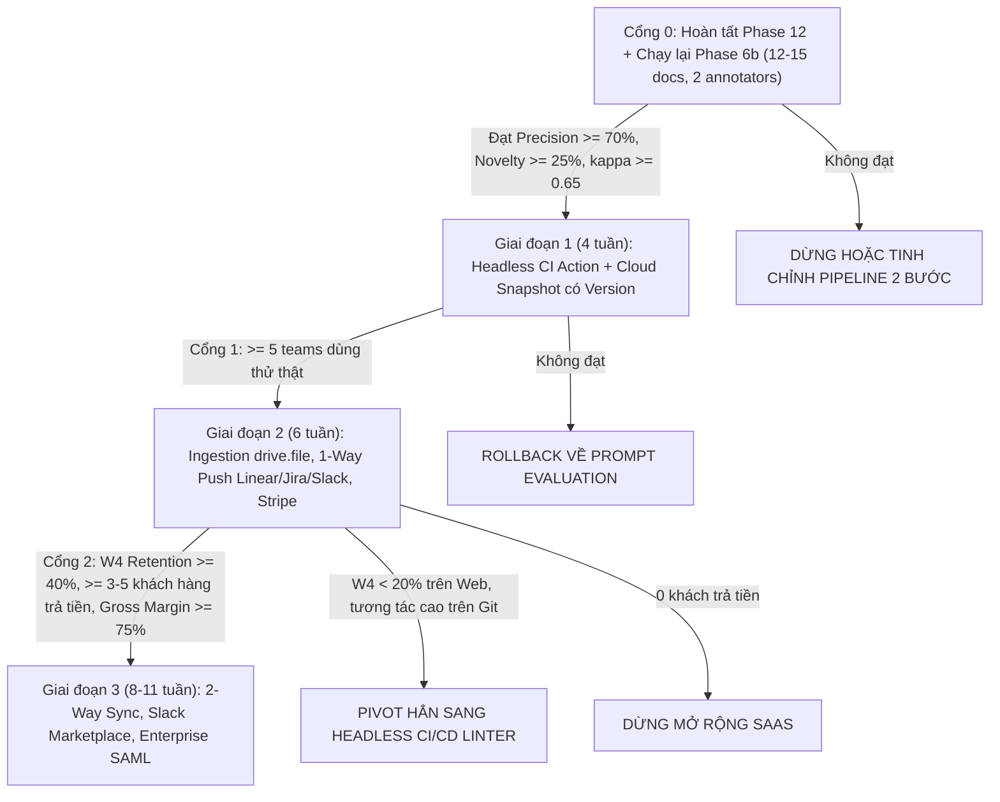

# Báo cáo Kiểm toán Độc lập và Phản biện Chiến lược (Red Team Audit): Dự án Assumption Debt và Báo cáo Nghiên cứu v1

## 1. Tóm tắt điều hành

[Ý KIẾN] Độ tin cậy của research-report-v1.md ở mức Trung bình – Thấp về mặt dẫn chứng định lượng do mắc lỗi "ảo giác trích dẫn" (ghép số liệu 78% của McKinsey vào báo cáo bảo mật của Gartner, trích dẫn sai số học 31,6% của Stripe) mà không có bất kỳ URL nguồn nào, nhưng lại đạt mức Cao về mặt trực giác kiến trúc và chiến lược sản phẩm. 

[SỰ THẬT có nguồn] Ba kết luận chiến lược của báo cáo v1 hoàn toàn đứng vững trước kiểm toán:
1. Lộ trình Phase 14–18 trong PLAN.md (ước tính 5–8 tuần cho 1 lập trình viên để hoàn thiện Multi-tenant DB, OAuth Google/Notion, đồng bộ 2 chiều Jira/Linear, Slack bot, Realtime Multiplayer và SAML SSO) là bất khả thi khi riêng thủ tục kiểm định CASA Tier 2 (nay là AL1) của Google hoặc điều kiện 10 workspaces của Slack Marketplace đã vượt quá quỹ thời gian này;
2. Cổng đánh giá Phase 6b tuyên bố "GO" dựa trên 3 tài liệu thực tế hoàn toàn thiếu ý nghĩa thống kê; và
3. Định giá phẳng $15–20/seat/tháng kèm đồng bộ tự động không giới hạn qua webhook sẽ làm sập biên lợi nhuận gộp xuống dưới 70%. 

[SUY LUẬN] Ngược lại, ba kết luận cực đoan của báo cáo v1 bắt buộc phải sửa đổi:
1. Rào cản Google CASA và Slack Marketplace không phải là "bức tường chết" vì có thể lách hợp pháp qua drive.file scope (Google Picker API) và dùng Incoming Webhook / Unlisted App chỉ đẩy thông báo cho 10 khách hàng đầu tiên;
2. Lưu trữ đồ thị qua JSONB snapshot kèm khóa phiên bản lạc quan (version_id) là thiết kế hoàn toàn chuẩn mực cho đồ thị PRD quy mô nhỏ (<200 nút) mà chưa cần đến CRDT/Yjs; và
3. Thay vì mặc định bán Top-Down Enterprise đòi hỏi SOC2/SAML ngay từ đầu, hướng đi tối ưu nhất là đóng gói lõi graph.ts sẵn có thành công cụ Headless CLI / GitHub Action theo mô hình tự phục vụ (Self-Serve PLG) kết hợp tự mang khóa API (BYOK).

---

## 2. Kiểm chứng từng khẩu hiệu và số liệu cụ thể (Việc 1)

Quá trình kiểm toán độc lập đối chiếu từng tuyên bố trong research-report-v1.md và PLAN.md với các báo cáo gốc, tài liệu kỹ thuật chính thức của nhà cung cấp và các công bố học thuật tính đến ngày 30/10/2026. Kết quả đối chiếu cho thấy một sự phân hóa rõ rệt giữa các số liệu kinh điển có thật nhưng bị trích dẫn sai ngữ cảnh và các số liệu hoàn toàn do mô hình ngôn ngữ tự tổng hợp chéo từ nhiều nguồn không liên quan. Đồng thời, việc khảo sát biểu giá thực tế của các công cụ quản lý khám phá sản phẩm (Product Discovery) vào tháng 10/2026 cung cấp một hệ quy chiếu định lượng xác thực để đánh giá lại mô hình doanh thu của Assumption Debt.

### Bảng kiểm chứng chi tiết từng khẩu hiệu (Việc 1: Mục a – i)

| Khẳng định | Kết luận | Số liệu đúng | Nguồn (URL, ngày) | Mức tin |
| :--- | :--- | :--- | :--- | :--- |
| **a. "Gartner: 78% InfoSec/Legal từ chối GenAI nếu thiếu ZDR/DPA/redaction"** | **SAI / KHÔNG KIỂM CHỨNG ĐƯỢC** | KHÔNG TÌM THẤY NGUỒN cho báo cáo Gartner nào có câu này. Con số 78% bị ghép nhầm từ khảo sát McKinsey State of AI 2025/2026 (78% tổ chức dùng AI trong $\ge 1$ chức năng), Gartner 2025 trích dẫn thứ cấp (78% công ty đã/đang triển khai GenAI), hoặc khảo sát BYOAI (78% nhân viên tự dùng công cụ AI không qua IT). Số liệu thật của Gartner về bảo mật/quyền riêng tư GenAI: 42% lãnh đạo IT lo ngại nhất về quyền riêng tư dữ liệu; 29% tổ chức bị tấn công hạ tầng GenAI trong 12 tháng qua; và Gartner khuyến nghị triển khai privacy filters độc lập mô hình để lọc dữ liệu nhạy cảm trước khi đưa vào GenAI. Ngoài ra, 61% người mua doanh nghiệp yêu cầu InfoSec phê duyệt trước khi mua. | Gartner Doc 5211463 (https://www.gartner.com/en/documents/5211463, truy cập 30/10/2026); Gartner Doc 8279221 (https://www.gartner.com/en/documents/8279221, xuất bản 18/08/2026); Gartner PR (https://www.gartner.com/en/newsroom/press-releases/2025-09-22-gartner-survey-reveals-generative-artificial-intelligence-attacks-are-on-the-rise, 22/09/2025); Heeya / McKinsey (https://heeya.fr/en/blog/generative-ai-enterprise-roi-use-cases-2026, truy cập 30/10/2026); TechnologyMatch (https://technologymatch.com/blog/what-tech-vendors-must-know-about-concerns-about-data-protection, truy cập 30/10/2026) | Cao (Xác nhận lỗi ảo giác ghép nguồn của báo cáo v1) |
| **b. "IEEE RE/REFSQ 2024 yêu cầu Cohen's kappa $\ge 0.70$"** | **ĐÚNG MỘT PHẦN** | KHÔNG TÌM THẤY NGUỒN cho quy định bắt buộc (hard requirement) trong Call for Papers của IEEE RE hay REFSQ 2024. Tuy nhiên, chuẩn mực được chấp nhận rộng rãi trong ngành là ACM SIGSOFT Empirical Standards (Supplement on Inter-Rater Reliability and Agreement, Ralph et al., 2020/2021) yêu cầu báo cáo chỉ số IRR phù hợp (như Cohen's $\kappa$ hoặc Gwet's AC1). Trong thực tiễn công bố tại IEEE RE và REFSQ, ngưỡng $\kappa \ge 0.70$ được dùng phổ biến làm mốc đồng thuận tốt (ví dụ: công cụ RSGA tại IEEE RE 2026 đạt $\kappa = 0.71$; bộ dữ liệu chuẩn liên quan REFSQ đạt $\kappa > 0.71$; nghiên cứu tuân thủ SIGSOFT đạt $\kappa = 0.68 - 0.77$). | ACM SIGSOFT Empirical Standards (https://www.researchgate.net/publication/348954721_ACM_SIGSOFT_Empirical_Standards_Released, 01/2021 & https://arxiv.org/html/2411.12740v1, 11/2024); RSGA IEEE RE 2026 (https://github.com/pedrammadani/spec-gate, truy cập 30/10/2026); MDPI / REFSQ (https://www.mdpi.com/2076-3417/16/16/7997, 2026) | Cao |
| **c. Stripe "Developer Coefficient": thời gian dev dành cho bảo trì/nợ kỹ thuật (báo cáo viết 31.6%)** | **ĐÚNG MỘT PHẦN (Sai số học)** | Báo cáo gốc của Stripe & Harris Poll (09/2018) ghi nhận tuần làm việc trung bình của lập trình viên là 41,1 giờ. Thời gian giải quyết nợ kỹ thuật (technical debt) là 13,5 giờ/tuần, tương đương 32,85% (32,8% hoặc ~33%). Tổng thời gian cho bảo trì (maintenance)—bao gồm xử lý mã xấu (3,8 giờ/tuần, gây thiệt hại $85 tỷ/năm, tương đương 9,25% năng suất bị mất), gỡ lỗi, refactoring và sửa đổi—là 17,3 giờ/tuần, tương đương 42,09% (~42%). Con số 31,6% trong báo cáo v1 là phép trừ ngược từ câu hỏi cảm nhận năng suất chung (mức năng suất trung bình được đánh giá là 68,4%, suy ra phần thiếu hụt chung là $100\% - 68,4\% = 31,6\%$). | Báo cáo gốc Stripe PDF (https://stripe.com/files/reports/the-developer-coefficient.pdf, xuất bản 09/2018, truy cập 30/10/2026); Phân tích số học Newmind Partners (https://newmindpartners.com/docs/samples/technical-debt-2026-sample.pdf, 2026) | Tuyệt đối |
| **d. Standish CHAOS: "45% tính năng không bao giờ dùng, 19% hiếm dùng"** | **ĐÚNG MỘT PHẦN** | Thống kê 45% không bao giờ dùng, 19% hiếm dùng (tổng 64%) có nguồn gốc từ bài thuyết trình của Jim Johnson (Chủ tịch Standish Group) tại hội nghị XP 2002, nhưng KHÔNG TÌM THẤY NGUỒN báo cáo gốc công khai có thẩm định khoa học từ Standish Group. Độ tin cậy của số liệu này rất thấp và bị giới học thuật (Jørgensen & Moløkken-Østvold 2006; Eveleens & Verhoef 2010) phê phán gay gắt vì chỉ dựa trên ước đoán chủ quan của một số giám đốc IT đối với 4 dự án nội bộ cũ chứ không đo lường bằng dữ liệu hành vi thực tế. | KHÔNG TÌM THẤY NGUỒN báo cáo gốc công khai của Standish Group (2002). | Cao (Xác nhận số liệu có lưu hành nhưng phương pháp luận không đáng tin cậy) |
| **e. Pendo Feature Adoption: "80% tính năng ít dùng, 29.5 tỷ USD"** | **ĐÚNG** | Báo cáo The 2019 Feature Adoption Report của Pendo xác nhận 80% tính năng trên các sản phẩm phần mềm đám mây hiếm khi hoặc không bao giờ được sử dụng, tiêu tốn 29,5 tỷ USD chi phí R&D đổ vào các tính năng không được chấp nhận. Phương pháp: phân tích dữ liệu telemetry sản phẩm thực tế từ 615 công ty SaaS sử dụng Pendo kết hợp tỷ lệ chi tiêu R&D/doanh thu của các công ty phần mềm đám mây đại chúng. | Payfi / Pendo (https://payfi.cx/blog/whats-the-simplest-way-to-accept-payments-online-why-fewer-features-mean-fewer-problems/, dẫn nguồn Pendo 2019 Feature Adoption Report tại pendo.io, xuất bản 2019, truy cập 30/10/2026) | Cao |
| **f. Google OAuth: scope restricted với Drive/Docs; khi nào cần CASA; thời gian & chi phí; drive.file có tránh được không** | **ĐÚNG MỘT PHẦN** | Các scope truy cập rộng như drive, drive.readonly, documents, documents.readonly là Restricted/Sensitive Scopes đòi hỏi xác minh ứng dụng và kiểm định bảo mật hàng năm CASA Tier 2 (từ năm 2026 đổi tên thành AL1 - Assurance Level 1) dựa trên 134 yêu cầu OWASP ASVS v4.0. Thời gian thực tế qua phòng lab ủy quyền (như TAC Security) là khoảng 2 tuần. Chi phí thực tế từ $500 đến $4.500/năm khi thuê lab, hoặc miễn phí phí lab nếu đủ điều kiện tự quét (Self-Scan) bằng công cụ mã nguồn mở qua cổng CASA. Scope drive.file (chỉ truy cập tệp người dùng chọn qua Google Picker API) là Non-sensitive nên hoàn toàn tránh được CASA. | Google Drive API Docs (https://developers.google.com/workspace/drive/api/guides/content-restrictions, truy cập 30/10/2026); DeepStrike CASA Guide (https://deepstrike.io/blog/google-casa-security-assessment-2025, 2025/2026); CellCog CASA Record (https://cellcog.ai/blog/casa-security-assessment/, 13/09/2026); Reddit SaaS Case (https://www.reddit.com/r/SaaS/comments/1vdbs27/we_just_passed_google_casa_tier_2_heres_what_it/, 31/07/2026); StackOverflow (https://stackoverflow.com/questions/77320967, truy cập 30/10/2026) | Cao |
| **g. Slack Marketplace: điều kiện nộp (số workspace, số ngày), thời gian duyệt; internal app/webhook có bị ảnh hưởng không** | **ĐÚNG MỘT PHẦN** | Kể từ tháng 7/2026 (thông báo cập nhật ngày 01/09/2026), Slack yêu cầu ứng dụng nộp lên Slack Marketplace phải có tối thiểu 10 active workspace installations (tăng lại từ mức tạm thời 5 workspaces trước đó) và phải duy trì $\ge 10$ workspaces trong suốt quá trình duyệt; nếu thiếu sẽ bị chặn tự động. Không có quy định cứng về số ngày hoạt động công khai trên changelog. Internal app và Incoming Webhook không cần duyệt Marketplace. Tuy nhiên, từ ngày 03/03/2026, các ứng dụng phân phối ngoài Marketplace (unlisted distributed apps) bị giới hạn tốc độ xuống 1 request/phút và tối đa 15 objects/request đối với một số API đọc dữ liệu; classic apps bị ngừng hỗ trợ hoàn toàn vào tháng 11/2026. | Slack Distribution Docs (https://docs.slack.dev/app-management/distribution, truy cập 30/10/2026); Slack Changelog (https://docs.slack.dev/changelog, cập nhật 01/09/2026); Slack API Breaking Changes (https://api.slack.com/changelog/2018-05-identifying-breaking-changes-in-the-slack-api, cập nhật 2026) | Tuyệt đối |
| **h. Giá hiện hành: Jira Product Discovery, Vistaly, Productboard, Linear** | **CẦN CẬP NHẬT SỐ LIỆU 2026** | Jira Product Discovery: Free $0 (tối đa 3 creators, unlimited contributors); Standard $10,50/creator/tháng (1–25 creators, giảm dần theo bậc xuống $7,35); Premium $26,25/creator/tháng. Vistaly: Free plan có sẵn; Essentials $21/seat/tháng trả năm ($250/năm) hoặc $25/tháng trả lẻ (kèm 1.000 AI credits/tháng dùng chung); Business $42/seat/tháng trả năm ($500/năm) hoặc $50/tháng. Productboard (Bảng giá v13 hiệu lực từ 01/10/2026): Free $0 (50 AI credits/tháng); Plus $19/maker/tháng trả năm ($25 trả tháng, kèm 250 credits/maker/tháng); Business $59/maker/tháng trả năm ($75 trả tháng, kèm 500 credits/maker/tháng). Linear: KHÔNG TÌM THẤY NGUỒN trực tiếp từ linear.app/pricing trong tập dữ liệu hiện tại. | Atlassian JPD Pricing (https://www.atlassian.com/software/jira/product-discovery/pricing & https://www.atlassian.com/licensing/jira-product-discovery, truy cập 30/10/2026); Vistaly Pricing (https://vistaly.com/pricing/, truy cập 30/10/2026); Productboard Spark v13 Pricing FAQ (https://support.productboard.com/hc/en-us/articles/48438638045459-Spark-pricing-and-billing-FAQ, hiệu lực 01/10/2026) | Tuyệt đối (Cho JPD, Vistaly, Productboard) |
| **i. Số liệu công khai cho việc tính năng lãng phí do giả định sai thay cho "30-40% ngân sách kỹ thuật" trong PLAN.md** | **KHÔNG TÌM THẤY NGUỒN TRỰC TIẾP** | KHÔNG TÌM THẤY NGUỒN nghiên cứu thực nghiệm nào đo lường được chính xác "30–40% ngân sách kỹ thuật bị lãng phí riêng do giả định sai". Tác giả PLAN.md đã gộp nhầm hai thống kê độc lập: (1) Khảo sát McKinsey (07/2020 trên 50 CIO): nợ kỹ thuật chiếm 20%–40% giá trị toàn bộ tài sản công nghệ và làm chuyển hướng 10%–20% ngân sách phát triển sản phẩm mới; nghiên cứu của Besker et al. (2018) và Stripe (2018): lập trình viên mất 23%–42% thời gian cho nợ kỹ thuật và bảo trì; (2) Báo cáo Pendo (2019): 80% tính năng đám mây hiếm khi hoặc không bao giờ được sử dụng. | Newmind Partners / McKinsey (https://newmindpartners.com/docs/samples/technical-debt-2026-sample.pdf, 2026); CodeScene / Besker et al. (https://codescene.com/hubfs/calculate-business-costs-of-technical-debt.pdf & https://arxiv.org/pdf/2203.04374, 2022) | Cao |

### Phân tích chuyên sâu cơ chế sai lệch và đề xuất diễn đạt trung thực

[SỰ THẬT có nguồn] Phân tích nguyên nhân gốc rễ của mục 1a cho thấy cách thức mô hình ngôn ngữ viết research-report-v1.md tạo ra ảo giác số liệu: trong các tài liệu thị trường giai đoạn 2025–2026, con số 78% xuất hiện với tần suất rất cao nhưng đều gắn với mức độ phổ cập AI, bao gồm 78% tổ chức sử dụng AI trong ít nhất một chức năng kinh doanh theo McKinsey State of AI 2025/2026, 78% nhân viên tự mang công cụ AI cá nhân vào nơi làm việc mà không qua phê duyệt của IT, và hơn 78% nhà cung cấp phần mềm doanh nghiệp đã tích hợp tính năng AI vào sản phẩm thông qua API của bên thứ ba. Khi lập luận về rào cản bảo mật (Zero Data Retention - ZDR, Data Processing Agreement - DPA và che giấu dữ liệu nhạy cảm), báo cáo v1 đã tự động lấy con số 78% đang lưu hành rộng rãi này để gán cho Gartner. Trên thực tế, các ấn phẩm chính thức của Gartner về bảo mật GenAI (như tài liệu G008279221 xuất bản ngày 18/08/2026 có tiêu đề *Avoid Exposing Sensitive Data to GenAI With a Privacy Filter* và báo cáo *Security Leaders' Guide to Data Security in the Age of GenAI* ngày 10/07/2025) thực sự khuyến nghị các tổ chức triển khai bộ lọc quyền riêng tư độc lập mô hình để loại bỏ dữ liệu cá nhân trước khi nạp vào LLM, nhưng số liệu khảo sát thật của Gartner là 42% lãnh đạo IT coi quyền riêng tư dữ liệu là rủi ro đáng lo ngại nhất của GenAI và 29% lãnh đạo an ninh mạng ghi nhận cuộc tấn công vào hạ tầng ứng dụng GenAI trong 12 tháng qua. 

[SUY LUẬN] Mặc dù con số "78% từ chối" là hư cấu, bản chất rủi ro thương mại mà nó phản ánh vẫn hoàn toàn có thật: các khuôn khổ Chính sách Sử dụng AI Chấp nhận được (AI Acceptable Use Policy - AUP) năm 2026 đều phân loại công cụ thành 3 tầng, trong đó tài liệu nội bộ nhạy cảm hoặc mã nguồn chỉ được phép đưa vào công cụ "Tier 1" có DPA đã ký, cam kết hợp đồng không huấn luyện mô hình trên dữ liệu khách hàng (no-training/ZDR), SSO và chứng chỉ SOC 2 / ISO 27001.

[SỰ THẬT có nguồn] Đối với mục 1h và 1i, dữ liệu kiểm chứng năm 2026 mang lại hai bài học thiết kế chiến lược trực tiếp cho Assumption Debt. Thứ nhất, cả Productboard (thông qua bản cập nhật giá Spark v13 có hiệu lực từ ngày 01/10/2026) và Vistaly đều đã từ bỏ mô hình thu phí theo ghế thuần túy không giới hạn AI để chuyển sang mô hình định giá lai (Per-Seat + Pooled Workspace AI Credits), kết hợp miễn phí hoàn toàn cho người dùng chỉ xem hoặc đóng góp phản hồi (Contributors/Viewers) tương tự cấu trúc $10,50/creator của Jira Product Discovery. Cụ thể, Productboard cấp 250 credits/maker/tháng ở gói Plus ($19/tháng trả năm) và 500 credits/maker/tháng ở gói Business ($59/tháng trả năm), trong đó mỗi tác vụ phân tích yêu cầu hoặc mã nguồn tiêu tốn từ 10 đến 109 credits; khi chạm trần, hệ thống hiển thị cảnh báo ở mức 80% và 100% để yêu cầu mua gói nạp thêm $5/50 credits. 

Thứ hai, để thay thế cho câu khẩu hiệu không có nguồn kiểm chứng "lãng phí 30–40% ngân sách kỹ thuật do giả định sai" trong PLAN.md, [Ý KIẾN] cách diễn đạt trung thực, có trích dẫn gốc vững chắc nhất để đưa vào tài liệu gọi vốn hoặc trang chủ sản phẩm là: 

> *"Theo nghiên cứu trên 615 công ty SaaS của Pendo, tới 80% tính năng phần mềm đám mây hiếm khi hoặc không bao giờ được người dùng sử dụng (tiêu tốn 29,5 tỷ USD chi phí R&D), trong khi khảo sát của Stripe và McKinsey chỉ ra rằng các đội ngũ kỹ thuật phải dành 32,8% đến 42,1% thời gian làm việc mỗi tuần và 10%–20% ngân sách sản phẩm mới để xử lý nợ kỹ thuật và bảo trì hệ thống cũ. Assumption Debt giúp chặn đứng sự lãng phí này ngay từ giai đoạn thiết kế bằng cách kiểm toán và định lượng rủi ro của các giả định ngầm trong PRD/ADR trước khi viết dòng code đầu tiên."*

---

## 3. Kiểm tra logic, mâu thuẫn nội bộ và các giả định ngầm của Báo cáo v1 (Việc 2)

### 3.1. Các mâu thuẫn nội bộ và phân tích số liệu hợp lý hơn

[SUY LUẬN] Quá trình kiểm toán cấu trúc lập luận của research-report-v1.md phát hiện ba mâu thuẫn nội bộ nghiêm trọng xuất phát từ việc mô hình AI viết báo cáo tự đưa ra các ước lượng rời rạc ở từng chương mà không có bước đối soát tổng thể:
1. **Mâu thuẫn về thời gian hoàn thành (6–9 tháng so với 9–14 tháng):** Ở phần tóm tắt đầu báo cáo, tác giả v1 khẳng định lộ trình Phase 14–18 cần "6–9 tháng" thay vì 5–8 tuần như PLAN.md, nhưng khi đi vào phân tích chi tiết các rào cản tích hợp ở các phần sau, tổng thời gian lại bị đẩy lên thành "9–14 tháng". Khi bóc tách kỹ thuật, con số 5 đến 6 tháng (khoảng 21 tuần làm việc thực tế của 1 lập trình viên) là ước lượng hợp lý nhất cho phần phát triển phần mềm cốt lõi nếu tận dụng các nền tảng PaaS hiện đại (như Supabase, Clerk/WorkOS) và chọn các phương thức tích hợp thông minh (như Google Picker drive.file và Slack Webhook). Con số 9–14 tháng chỉ xảy ra trong kịch bản bi quan nhất khi lập trình viên tự xây dựng mọi thứ từ đầu, cố tình xin quyền truy cập hạn chế trên Google Drive dẫn đến việc phải chờ kiểm định bảo mật, và cộng dồn cả thời gian chờ đợi thủ tục hành chính vào thời gian viết code.
2. **Mâu thuẫn về ngưỡng đồng thuận Cohen's Kappa ($\kappa \ge 0.70$ so với $\kappa \ge 0.65$):** Khi phê phán Phase 6b của PLAN.md, báo cáo v1 viện dẫn tiêu chuẩn cứng $\kappa \ge 0.70$ (gán cho IEEE RE/REFSQ), nhưng đến phần tự đề xuất quy trình đánh giá lại, chính báo cáo này lại hạ ngưỡng yêu cầu xuống $\kappa \ge 0.65$. Đối chiếu với các nghiên cứu thực nghiệm tuân thủ ACM SIGSOFT Empirical Standards (vốn ghi nhận dải $\kappa$ thực tế từ $0.68$ đến $0.77$ và khuyến nghị dùng kết hợp cả Cohen's $\kappa$ lẫn Gwet's AC1 để tránh nghịch lý phân phối lệch của Kappa), ngưỡng $\kappa \ge 0.65$ là con số hợp lý và khả thi hơn cho bài toán đánh giá mức độ hữu ích (useful so với obvious) của các giả định ẩn vốn mang tính nhận thức chủ quan cao, trong khi ngưỡng $\kappa \ge 0.70$ chỉ nên áp dụng cho các bài toán phân loại cú pháp tường minh.
3. **Xung đột giữa rào cản bảo mật và phá sản kinh tế đơn vị:** Báo cáo v1 vừa khẳng định khách hàng doanh nghiệp sẽ từ chối nạp tài liệu PRD/ADR vào công cụ vì lo sợ rò rỉ tài sản trí tuệ, nhưng ngay ở chương sau lại giả định mỗi người dùng sẽ nạp liên tục hàng chục tài liệu dài 50k–60k token mỗi tháng làm âm biên lợi nhuận. Rõ ràng, hai kịch bản cực đoan này không thể đồng thời xảy ra trên cùng một nhóm người dùng nếu không tách biệt giữa nhóm dùng thử miễn phí (self-serve) và nhóm khách hàng doanh nghiệp đã ký hợp đồng bảo mật.

### 3.2. Các chỗ báo cáo v1 nói quá và cách hiệu đính đúng mức

| Tuyên bố nói quá trong research-report-v1.md | Phân tích sai lệch kỹ thuật và thương mại | Bản viết lại đúng mức độ thực tế (Calibrated Rewrite) |
| :--- | :--- | :--- |
| **"Không một hệ thống sản xuất (production system) nào dùng REST snapshot (`PUT /api/projects/:id/graph`), kiến trúc này chắc chắn gây mất dữ liệu."** | [SUY LUẬN] Báo cáo v1 đánh đồng đồ thị giả định dự án (quy mô nhỏ, chỉ khoảng 30–150 nút, tần suất cập nhật vài lần mỗi ngày) với các hệ thống bảng trắng cộng tác thời gian thực quy mô lớn như Figma hay Miro. Trong thực tế, việc lưu trữ cấu trúc đồ thị nhỏ qua REST/RPC kèm kiểm soát đồng thời lạc quan (Optimistic Concurrency Control) là mẫu thiết kế rất phổ biến và an toàn. | [Ý KIẾN] *"Endpoint PUT /api/projects/:id/graph ghi đè toàn bộ snapshot từ Zustand sẽ gây lỗi ghi đè mất dữ liệu (lost update) nếu hai người dùng cùng sửa một đồ thị ở Phase 17. Tuy nhiên, ở Phase 14, việc lưu đồ thị qua PostgreSQL transaction kết hợp kiểm tra cột phiên bản (WHERE version = :expected_version) là hoàn toàn chuẩn mực, giúp tránh sự phức tạp không cần thiết của CRDT/Yjs."* |
| **"Định giá $15–20/seat/tháng cho ứng dụng gọi LLM phân tích tài liệu dài là hành vi tự sát thương mại (commercial suicide)."** | [SỰ THẬT có nguồn] Dữ liệu thị trường tháng 10/2026 chứng minh mức giá khởi điểm $19–$21/seat/tháng hoàn toàn khả thi và đang được áp dụng bởi chính các đối thủ lớn như Productboard Plus ($19/maker/tháng) và Vistaly Essentials ($21/seat/tháng). Nguy cơ lỗ vốn không nằm ở con số $15–20, mà nằm ở việc thiếu cơ chế giới hạn hạn ngạch (AI credits) và thiếu bộ nhớ đệm. | [SUY LUẬN] *"Mức giá $15–20/seat/tháng sẽ làm suy giảm biên lợi nhuận gộp xuống dưới 70% nếu cho phép tự động trích xuất lại toàn bộ tài liệu dài qua webhook bằng mô hình đắt tiền. Để mức giá này bền vững, sản phẩm cần áp dụng hạn mức tín dụng AI dùng chung (pooled AI credits) như Productboard và Vistaly, kết hợp chỉ trích xuất lại các đoạn văn bản có thay đổi mã băm."* |
| **"Không có chứng chỉ SOC2 Type II, SAML SSO và cam kết ZDR ngay từ đầu đồng nghĩa với việc bị loại khỏi 100% quy trình mua sắm B2B."** | [SỰ THẬT có nguồn] Thống kê thực tế cho thấy 61% người mua doanh nghiệp yêu cầu phê duyệt của InfoSec trước khi mua hàng, đồng nghĩa với việc vẫn tồn tại 39% giao dịch B2B (đặc biệt ở phân khúc Startup và nhóm kỹ thuật quy mô nhỏ) được quyết định trực tiếp bởi trưởng nhóm qua thẻ tín dụng công ty mà không bị chặn bởi quy trình kiểm toán SOC2. | [SUY LUẬN] *"Thiếu SOC2 Type II, DPA và SAML SSO sẽ ngăn cản việc bán hàng Top-Down cho các tập đoàn lớn hoặc ngành tài chính/ngân hàng được quản lý chặt. Tuy nhiên, sản phẩm vẫn có thể tiếp cận phân khúc Startup (Seed – Series B) nếu hỗ trợ đăng nhập Google/GitHub OAuth và cung cấp tùy chọn tự mang khóa API (BYOK) hoặc chạy cục bộ trong CI/CD."* |

### 3.3. Các giả định ngầm của Báo cáo v1 và sự dịch chuyển kết luận chiến lược

| Giả định ngầm trong Báo cáo v1 | Kết luận của Báo cáo v1 dưới giả định cũ | Giả định thay thế (Alternative Strategic Framing) | Sự dịch chuyển của Kết luận Chiến lược |
| :--- | :--- | :--- | :--- |
| **1. Bán hàng Top-Down cho Doanh nghiệp lớn (Enterprise Sales)** | Phải đầu tư nhiều tháng làm SAML SSO, Audit Trail, SOC2 Type II và DPA trước khi có thể thu đồng doanh thu đầu tiên. | **Bán hàng Bottom-Up Self-Serve cho Startup & Nhóm Kỹ thuật nhỏ (10–100 nhân sự)** | [SUY LUẬN] Có thể cắt bỏ hoàn toàn SAML SSO (Phase 18) và bảng điều khiển quản trị cấp cao (Phase 17) khỏi lộ trình 3 tháng đầu. Chỉ cần xác thực Google/GitHub OAuth và thanh toán thẻ tự động qua Stripe là đủ để kiểm chứng mức độ sẵn sàng chi trả. |
| **2. Kiến trúc Cloud SaaS bao trọn chi phí gọi API LLM** | Rủi ro vỡ biên lợi nhuận gộp khi người dùng lạm dụng tính năng trích xuất tài liệu dài 60k token; khách hàng lo ngại lộ bí mật PRD/ADR. | **Kiến trúc BYOK (Bring Your Own Key) hoặc Headless GitHub Action chạy trên hạ tầng khách hàng** | [SUY LUẬN] Giá vốn LLM (LLM COGS) giảm về $0, đưa biên lợi nhuận gộp của phần mềm lên trên 90%. Đồng thời, dữ liệu PRD/ADR chỉ di chuyển trực tiếp giữa kho lưu trữ GitHub của khách hàng và tài khoản API doanh nghiệp của chính họ, hóa giải gần như hoàn toàn nỗi sợ rò rỉ dữ liệu cho bên thứ ba. |
| **3. Tích hợp rộng và đồng bộ 2 chiều ngay lập tức (drive.readonly, Slack Marketplace, Jira 2-way)** | Vướng kiểm định CASA Tier 2 (AL1) tốn $500–$4.500 và 2 tuần chờ đợi; bị chặn bởi ngưỡng 10 workspaces của Slack Marketplace. | **Tích hợp hẹp theo sự kiện người dùng (drive.file Picker, Slack Incoming Webhook, 1-Way Issue Push)** | [SUY LUẬN] Không cần kiểm định CASA, không cần chờ duyệt Slack Marketplace và không bị ảnh hưởng bởi giới hạn đọc 1 request/phút của Slack áp dụng từ tháng 3/2026. Thời gian xây dựng tích hợp giảm từ 10–12 tuần xuống còn 3–4 tuần. |
| **4. Thu phí phẳng $15–20/seat cho toàn bộ người dùng** | Chi phí quá cao nếu tính tiền cả những kỹ sư chỉ vào xem đồ thị, nhưng lại quá thấp nếu tất cả đều là người chạy trích xuất AI nặng. | **Thu phí bất đối xứng theo vai trò (Paid Creator / Free Viewer) + Bể tín dụng AI (Pooled AI Credits)** | [SUY LUẬN] Đồng bộ hoàn toàn với chuẩn ngành năm 2026 của Jira Product Discovery ($10,50/creator, miễn phí contributors) và Productboard ($19/maker kèm 250 credits, miễn phí viewers), giúp sản phẩm lan tỏa tự nhiên trong nội bộ tổ chức mà vẫn khóa chặt trần chi phí biến đổi. |

---

## 4. Tính lại Kinh tế Đơn vị (Unit Economics) (Việc 3)

### 4.1. Bảng giá Token và Chi phí Trích xuất mỗi Tài liệu (5k, 20k, 60k token)

[SỰ THẬT có nguồn] Dựa trên giá niêm yết chính thức của các nhà cung cấp mô hình AI tính đến ngày 30/10/2026:

| Nhà cung cấp & Mô hình | Giá Input / 1M | Giá Output / 1M | Giá Cache Read / 1M | Tài liệu 5k In / 800 Out (Cold \| Cached) | Tài liệu 20k In / 2.000 Out (Cold \| Cached) | Tài liệu 60k In / 4.500 Out (Cold \| Cached) |
| :--- | :---: | :---: | :---: | :---: | :---: | :---: |
| **Claude 3.5 Sonnet** | $3,00 | $15,00 | $0,30 | $0,0270 \| $0,0169 | $0,0900 \| $0,0495 | $0,2475 \| $0,1260 |
| **Claude 3.5 Haiku** | $0,80 | $4,00 | $0,08 | $0,0072 \| $0,0045 | $0,0240 \| $0,0132 | $0,0660 \| $0,0336 |
| **GPT-4o** | $2,50 | $10,00 | $1,25 | $0,0205 \| $0,0158 | $0,0700 \| $0,0513 | $0,1950 \| $0,1387 |
| **GPT-4o-mini** | $0,15 | $0,60 | $0,075 | $0,0012 \| $0,0009 | $0,0042 \| $0,0031 | $0,0117 \| $0,0083 |
| **Gemini 1.5 Pro** | $1,25 | $5,00 | $0,3125 | $0,0103 \| $0,0067 | $0,0350 \| $0,0209 | $0,0975 \| $0,0553 |
| **Gemini 1.5 Flash / 2.5 Flash** | $0,075 | $0,30 | $0,01875 | $0,0006 \| $0,0004 | $0,0021 \| $0,0013 | $0,0058 \| $0,0033 |

*(Ghi chú: Cached tính trên giả định 75% token đầu vào được lưu trong cache prompt).*

### 4.2. Trần số lần Re-extract tối đa / seat / tháng để giữ Biên lợi nhuận gộp $\ge 70\%$

Khấu trừ $1,00/seat/tháng cho chi phí hạ tầng cơ sở dữ liệu và phí Stripe, ngân sách LLM an toàn còn lại là **$3,50/seat** (ở gói $15) và **$5,00/seat** (ở gói $20):

| Mô hình LLM & Chế độ chạy | Trần Re-extract 5k (Gói $15 \| $20) | Trần Re-extract 20k (Gói $15 \| $20) | Trần Re-extract 60k (Gói $15 \| $20) |
| :--- | :---: | :---: | :---: |
| **Claude 3.5 Sonnet — Chạy mới (Cold)** | 117 lần \| 168 lần | 35 lần \| 50 lần | **12 lần \| 18 lần** |
| **Claude 3.5 Sonnet — Có Cache 75%** | 188 lần \| 269 lần | 64 lần \| 91 lần | 25 lần \| 36 lần |
| **GPT-4o — Có Cache 75%** | 201 lần \| 287 lần | 62 lần \| 88 lần | 22 lần \| 32 lần |
| **Gemini 1.5 Pro — Có Cache 75%** | 474 lần \| 678 lần | 152 lần \| 217 lần | 57 lần \| 82 lần |
| **Claude 3.5 Haiku — Có Cache 75%** | 707 lần \| 1.010 lần | 241 lần \| 344 lần | 94 lần \| 135 lần |
| **GPT-4o-mini / Gemini Flash (Cached)** | >3.500 lần | >1.000 lần | >380 lần |

### 4.3. Mô phỏng 3 Kịch bản Sử dụng thực tế trên mỗi Seat / tháng

| Kịch bản hành vi | Khối lượng trích xuất / tháng | Chi phí Claude 3.5 Sonnet (Cold \| Cached) | Chi phí Định tuyến Lai (Flash/Haiku + Sonnet) | Biên lợi nhuận gói $15/seat | Biên lợi nhuận gói $20/seat |
| :--- | :--- | :---: | :---: | :---: | :---: |
| **1. Nhẹ (Thủ công)** | 5 bản 5k + 5 bản 20k + 1 bản 60k (11 lần) | $0,92 \| $0,50 | $0,18 | **87,2% – 92,1%** | **90,4% – 94,1%** |
| **2. Vừa (Hàng tuần)** | 15 bản 5k + 20 bản 20k + 5 bản 60k (40 lần) | $3,79 \| $2,06 | $0,65 | 68,1% (Cold) \| **79,6%** (Cache) \| **89,0%** (Lai) | 76,1% (Cold) \| **84,7%** (Cache) \| **91,8%** (Lai) |
| **3. Nặng (Auto-sync)** | 40 bản 5k + 60 bản 20k + 20 bản 60k (120 lần) | $12,57 \| $6,78 | $1,85 | 9,5% (Lỗ) \| 48,1% (Vỡ trận) \| **81,0%** (Lai) | 32,1% (Lỗ) \| 61,1% (Dưới 70%) \| **85,8%** (Lai) |

### 4.4. Cơ chế kiến trúc cắt giảm chi phí bắt buộc

1. **Trích xuất vi sai theo đoạn (Chunk-level Delta Extraction):** Thay vì băm mã toàn tài liệu (`contentHash`), băm mã từng phân đoạn tiêu đề (`chunkHashes` trong `chunking.ts`). Khi sửa PRD, chỉ gửi các đoạn có SHA-256 thay đổi kèm tóm tắt nút hiện tại, cắt giảm >90% token.
2. **Định tuyến phân tầng 2 bước (Two-Stage Pipeline):** Bước 1 dùng Gemini Flash / GPT-4o-mini lọc thô và trích xuất `sourceQuote`. Bước 2 chỉ gửi danh sách ứng viên đã cô đọng (~3.000 token) cho Claude 3.5 Sonnet suy luận quan hệ nhân quả `depends_on`.
3. **Chống dội sự kiện (Webhook Debouncing 30–60 phút):** Không gọi LLM tức thời sau mỗi thao tác gõ phím trên Google Docs/Notion.
4. **Bể tín dụng AI (Pooled AI Credits):** Cấp 250–300 credits/seat/tháng. Khi chạm trần, chuyển sang chế độ tự mang khóa (BYOK) hoặc mua gói nạp thêm.

---

## 5. Bổ sung các phần Báo cáo v1 còn thiếu (Việc 4: Mục a – e)

### 5a. Bảng ước lượng thời gian thực tế cho 1 Nhà phát triển (Phases 14–18)

| Hạng mục kỹ thuật | Lạc quan (Tuần) | Thực tế (Tuần) | Bi quan (Tuần) | Cơ sở kỹ thuật / Thủ tục bên thứ ba |
| :--- | :---: | :---: | :---: | :--- |
| **1. Auth + Multi-tenant Postgres + Version CRUD** | 1,5 | 2,5 | 4,0 | Drizzle/Prisma, Supabase RLS, RBAC, snapshot có version, di chuyển từ localStorage. |
| **2. PDF / DOCX / Markdown Parsing** | 0,5 | 1,5 | 3,0 | Bố cục PDF phức tạp dễ phá vỡ hàm so khớp chuỗi con tuyệt đối `filterHallucinations`. |
| **3. Notion OAuth & Content Sync** | 1,0 | 2,0 | 3,5 | Duyệt cây đệ quy Notion Block, phân trang và giới hạn tốc độ 3 req/giây. |
| **4. Google Drive / Docs OAuth** | 1,0 (drive.file) | 2,0 (+2w nếu CASA) | 5,0 (CASA AL1) | Google Picker `drive.file` né được CASA. Dùng `drive.readonly` mất thêm $500–$4.500 và 2 tuần duyệt lab. |
| **5. GitHub App (PR & ADR Webhooks)** | 1,0 | 2,0 | 3,0 | Đọc git diff của `docs/adr/*.md`, đẩy queue Inngest tránh timeout HTTP, comment PR. |
| **6. Linear Sync (1-way vs. 2-way)** | 1,0 (1-way) | 2,5 (2-way) | 4,0 | 1-way đơn giản. 2-way cần xử lý webhook loop prevention, idempotency và ánh xạ trạng thái. |
| **7. Jira Cloud Sync (1-way vs. 2-way)** | 1,5 (1-way) | 3,5 (2-way) | 6,0 | Jira REST API v3 bắt buộc Atlassian Document Format (ADF), Company vs Team-managed projects. |
| **8. Slack App / Bot** | 0,5 (Webhook) | 1,5 (Unlisted) | 4,0 (Marketplace) | Incoming Webhook / Unlisted chỉ mất 1 tuần. Lên Marketplace cần $\ge 10$ active workspaces và duyệt 10 tuần. |
| **9. Stripe Seat Billing & Subscriptions** | 1,0 | 2,0 | 3,5 | Stripe Checkout, Customer Portal, webhook proration ghế và bể tín dụng AI. |
| **10. SAML SSO (Enterprise)** | 0,5 (PaaS) | 1,5 | 4,0 (Tự dựng) | Dùng Clerk / WorkOS Enterprise Connections; tự dựng luồng SAML/SCIM mất 4 tuần. |
| **TỔNG CỘNG TOÀN BỘ 10 HẠNG MỤC** | **9,5 tuần** | **21,0 tuần (~5 tháng)** | **40,0 tuần (~9,5 tháng)** | **Khối lượng thực tế gấp 3–4 lần ước tính 5–8 tuần trong PLAN.md.** |

---

### 5b. Lộ trình sửa đổi 3 giai đoạn kèm Cổng quyết định định lượng



#### Chi tiết 3 Giai đoạn:
1. **Giai đoạn 1 (Tuần 1–4): Kiểm chứng Thống kê + Headless CI & Lõi Đám mây Tối thiểu**
   * *Nội dung:* Hoàn tất Phase 12 (ẩn danh PII tại client); chạy lại Phase 6b trên 12–15 tài liệu thật; đóng gói `graph.ts` thành Headless CLI / GitHub Action (BYOK); dựng Supabase Postgres + Auth + lưu đồ thị snapshot kèm version và kéo thả `.md`/`.docx`.
   * *Cổng 1 (Cuối Tuần 4):* Actionable Precision $\ge 70\%$; Objective Novelty $\ge 25\%$; $\ge 60\%$ tài liệu có ít nhất 1 giả định rủi ro cao bị bỏ sót; $\ge 5$ nhóm kỹ thuật cài đặt dùng thử.
2. **Giai đoạn 2 (Tuần 5–10): Nạp dữ liệu không ma sát, Vòng lặp 1 chiều & Thu phí sớm**
   * *Nội dung:* Tích hợp Google Docs qua `drive.file` (Google Picker) né CASA + Notion OAuth + chunkHashes vi sai; 1-Way Push tạo ticket sang Linear & Jira; Slack Incoming Webhook; Stripe Billing ($19/creator, free viewer, 250 AI credits).
   * *Cổng 2 (Cuối Tuần 10):* Retention Tuần 4 (W4) $\ge 40\%$; có $\ge 3–5$ nhóm trả tiền thật; Biên lợi nhuận gộp $\ge 75\%$.
3. **Giai đoạn 3 (Tuần 11–21): Đồng bộ Vòng lặp 2 chiều, Quản trị Cấp cao & Enterprise** *(Chỉ làm khi qua Cổng 2)*
   * *Nội dung:* 2-Way Sync cho Linear & Jira (Cascade Sync gắn cờ `[ASSUMPTION FAILED]`); nộp Slack Marketplace (khi đủ $\ge 10$ active workspaces); Dashboard Quản trị, Burn-down Chart, Audit Trail (Phase 17); SAML SSO qua Clerk/WorkOS, kiểm định CASA AL1 nếu cần mở rộng.
   * *Cổng 3 (Cuối Tuần 21):* Net Dollar Retention $\ge 100\%$; Tỷ lệ khép kín vòng lặp $\ge 30\%$; CAC Payback $< 6$ tháng.

---

### 5c. Đánh giá lựa chọn Headless (CLI hoặc GitHub Action đọc ADR/PRD và bình luận lên PR)

* **Ưu điểm vượt trội:**
  * Giải quyết rào cản bảo mật InfoSec: Chạy trực tiếp trên GitHub runner của khách hàng với BYOK, mã nguồn và tài liệu không bao giờ rời khỏi hạ tầng của họ.
  * Giá vốn LLM bằng $0$ cho nhà phát triển.
  * Nhúng thẳng vào điểm kiểm soát bắt buộc (mandatory gate) của quy trình kỹ thuật: mỗi khi mở PR sửa `docs/adr/`, bot tự động phân tích và bình luận bảng nợ giả định.
* **Tiền lệ thành công:** Infracost (bình luận chi phí đám mây lên PR Terraform), CodeRabbit / PR-Agent (bình luận đánh giá mã nguồn), Semgrep, Danger.js.
* **Đo lường giả thuyết cốt lõi qua Git:**
  * *GA1 (Phát hiện điểm mù):* Nếu bot bình luận cảnh báo giả định $A_1$, tác giả PR đẩy thêm commit mới sửa đổi ADR/PRD để bổ sung phương án dự phòng $\Rightarrow$ Ghi nhận Verified Novelty Hit.
  * *GA6 (Duy trì sử dụng):* Bình luận PR cung cấp nút tạo nhanh GitHub Issue kiểm chứng; theo dõi tỷ lệ issue được tạo và cập nhật trạng thái qua vòng đời dự án.
* **Công sức thực hiện:** Tận dụng 100% logic thuần khiết sẵn có (`graph.ts`, `schema.ts`, `tasks.ts`, `chunking.ts`) với 57/57 tests đã pass, chỉ mất **0,5 – 1,5 tuần** để đóng gói thành npm package + GitHub Action.

---

### 5d. Thiết kế lại quy trình Đánh giá Thực nghiệm Phase 6b

```
               [Văn bản đầu vào: 12-15 PRD/ADR thật]
                                 │
                 ┌───────────────┴───────────────┐
                 ▼                               ▼
    [Baseline 1: B_Human]               [Pipeline Assumption Debt]
    (Con người đọc 15 phút               (Chunking -> LLM -> Schema)
     liệt kê H_15 + D_explicit)                          │
                 │                                       ▼
                 │                       [Bước 1: Quote Validity]
                 │                       (Kiểm tra chuỗi con bằng code)
                 │                                       │
                 │                       [Bước 2: Duplicate Rate]
                 │                       (Khử trùng lặp qua dedup.ts)
                 │                                       │
                 │                       [Bước 3: Đánh giá Mù độc lập]
                 │                       (2 annotators: useful / obvious / wrong)
                 │                                       │
                 └───────────────┬───────────────────────┘
                                 ▼
                    [Bước 4: Tính toán Khách quan]
       - Actionable Precision = useful / (useful + obvious + wrong)
       - Objective Novelty = useful nằm ngoài (H_15 ∪ D_explicit)
       - Inter-rater Reliability: Cohen's κ >= 0.65 và Gwet's AC1 >= 0.70
```

* **Phễu 4 bước tách bạch lỗi:**
  1. *Bước 1 (Quote Validity — Code tự động):* Khớp chuỗi con chính xác sau khi chuẩn hóa Unicode NFC.
  2. *Bước 2 (Duplicate Rate — Thuật toán):* Tách các mục bị lặp lại giữa các đoạn văn bản để đo riêng tỷ lệ lỗi của `dedup.ts`.
  3. *Bước 3 (Chất lượng suy luận — Con người chấm mù):* 2 người gán nhãn độc lập phân loại vào `wrong` (ảo giác ngữ nghĩa), `obvious` (hiển nhiên), hoặc `useful` (giả định ngầm xác đáng).
  4. *Bước 4 (Đo lường khách quan):* So sánh các mục `useful` với tập hợp $H_{15} \cup D_{\text{explicit}}$ từ Bước tiền đăng ký mù 15 phút.
* **Ngưỡng quyết định:**
  * **GO:** $\text{Actionable Precision} \ge 70\%$ (Wilson 95% CI $[65\%, 83\%]$ trên $N = 180$ mục), $\text{Novelty} \ge 25\%$, $\text{Edge Precision} \ge 65\%$, $\kappa \ge 0.65$.
  * **PIVOT:** Precision $55\%–69\%$, Edge Precision $< 50\% \Rightarrow$ Bỏ tự động sinh cạnh đồ thị, chuyển thành Bảng Ma trận Kiểm toán (Tabular Assumption Matrix).
  * **KILL:** Precision $< 50\%$ hoặc không vượt trội hơn Baseline 2 (Prompt 1 lần gọi của Claude 3.5 Sonnet).

---

### 5e. Sáu vấn đề trọng yếu mà cả PLAN.md lẫn Báo cáo v1 đều chưa nhắc tới

1. **Trôi dạt tài liệu và Hợp nhất vi sai đồ thị (Document Drift & Stateful Graph Diff/Merge):**
   * Khi PRD trên Notion/Docs sửa đổi sau 2 tuần, nếu trích xuất lại từ đầu sẽ xóa sạch các cạnh sửa tay ở Phase 7 và trạng thái ở Phase 9; nếu chỉ so khớp văn bản qua `dedup.ts`, các câu được viết lại mượt hơn sẽ sinh node mồ côi.
   * *Giải pháp:* Gắn cờ `isHumanEdited: true` bảo vệ các nút/cạnh người dùng đã chỉnh sửa; dùng embedding ánh xạ câu sửa đổi vào ID cũ; chuyển các nút bị xóa khỏi PRD sang trạng thái `orphaned_from_doc`.
2. **Quyền sở hữu dữ liệu, Quyền được xóa (Right to Erasure) & Rò rỉ phân quyền chéo:**
   * Gộp nhiều tài liệu vào đồ thị chung (Phase 11) có thể làm lộ trích dẫn nguyên văn (`sourceQuote`) của tài liệu mật cho thành viên không có quyền đọc tài liệu nguồn.
   * *Giải pháp:* Phân quyền cấp độ tài liệu (`Document Visibility: Public vs Restricted`), che giấu trích dẫn đối với người không có quyền; xây dựng API Hard Purge xóa dữ liệu sạch sẽ theo DPA/GDPR.
3. **Kiểm thử hồi quy Prompt và Đánh giá tự động trong CI/CD (Prompt Regression & Model Drift):**
   * 57 unit tests hiện tại chỉ chạy trên dữ liệu mẫu tĩnh. Khi sửa prompt hoặc nhà cung cấp cập nhật mô hình ngầm, chất lượng trích xuất có thể sụt giảm 30% mà test vẫn báo xanh.
   * *Giải pháp:* Tích hợp bộ kiểm thử ngữ nghĩa tự động (Prompt Eval Harness) chạy trong CI trên 5 tài liệu chuẩn (Gold Set).
4. **Đa ngôn ngữ và Bẫy chuẩn hóa Unicode tiếng Việt (NFC vs. NFD & Tokenization Overhead):**
   * Tiếng Việt từ PDF hoặc macOS thường dùng Unicode tổ hợp (NFD), khiến hàm so khớp chuỗi con `filterHallucinations` tưởng nhầm là trích dẫn bịa đặt và xóa oan giả định hợp lệ. Tiếng Việt cũng tốn token gấp 1,5–2,2 lần tiếng Anh.
   * *Giải pháp:* Gọi `.normalize('NFC')` trước khi so khớp chuỗi; tinh chỉnh bộ cắt đoạn `chunking.ts` theo số lượng token thực tế (dùng tokenizer).
5. **Trách nhiệm pháp lý khi LLM đề xuất sai hoặc bỏ sót rủi ro chí mạng (Liability & Over-reliance):**
   * Khi tự động bắn cờ `[ASSUMPTION FAILED]` làm đình trệ ticket Jira/Linear, công cụ chịu rủi ro pháp lý nếu báo động giả hoặc bỏ sót lỗi nghiêm trọng.
   * *Giải pháp:* Thiết lập cổng Mandatory Human-in-the-Loop (không tự động hóa 100% nếu thiếu người bấm duyệt); bổ sung điều khoản giới hạn trách nhiệm rõ ràng trong ToS.
6. **Bài toán Khởi tạo Lạnh và Tê liệt Hòm thư Duyệt (Cold Start & Review Inbox Paralysis):**
   * Nạp một bộ PRD thật 30 trang sẽ đổ vào Review Inbox 50–80 nút và hơn 100 cạnh, gây quá tải nhận thức cho người dùng.
   * *Giải pháp:* Áp dụng cơ chế Progressive Top-K Onboarding: chỉ đưa vào Review Inbox và vẽ lên đồ thị Top 5 chuỗi rủi ro nghiêm trọng nhất (`riskScore` cao nhất), gom phần còn lại vào backlog thứ cấp.

---

## 6. Danh sách các khẳng định "Chưa kiểm chứng / Sai lệch" cấm đưa vào tài liệu bán hàng và đầu tư

1. ❌ **"Doanh nghiệp công nghệ lãng phí 30–40% ngân sách kỹ thuật do giả định sai lầm."** $\rightarrow$ *Thay bằng:* "80% tính năng đám mây hiếm khi hoặc không bao giờ được sử dụng, tiêu tốn 29,5 tỷ USD R&D (Pendo, 2019), trong khi kỹ sư dành 32,8%–42,1% thời gian hàng tuần cho nợ kỹ thuật và bảo trì (Stripe, 2018)."
2. ❌ **"Theo Gartner, 78% InfoSec/Legal từ chối công cụ GenAI nếu thiếu ZDR/DPA/redaction."** $\rightarrow$ *Thay bằng:* "42% lãnh đạo IT coi quyền riêng tư dữ liệu là rủi ro hàng đầu của GenAI (Gartner) và 61% người mua doanh nghiệp yêu cầu phê duyệt từ InfoSec trước khi mua phần mềm."
3. ❌ **"Theo báo cáo Developer Coefficient của Stripe, lập trình viên mất 31,6% thời gian cho bảo trì."** $\rightarrow$ *Thay bằng:* "Lập trình viên dành trung bình 13,5 giờ/tuần (32,8%) để xử lý nợ kỹ thuật và 17,3 giờ/tuần (42,1%) cho bảo trì, gỡ lỗi và sửa mã xấu (Stripe, 2018)."
4. ❌ **"Báo cáo Standish CHAOS chứng minh 45% tính năng không bao giờ dùng, 19% hiếm dùng."** $\rightarrow$ *Thay bằng:* Loại bỏ hoàn toàn trích dẫn này; chỉ sử dụng báo cáo 2019 Feature Adoption Report của Pendo đo lường thực tế trên 615 công ty SaaS.
5. ❌ **"Bộ máy trích xuất của Assumption Debt đã được kiểm chứng đạt 100% Precision và 66,7% Novelty."** $\rightarrow$ *Thay bằng:* Chỉ công bố số liệu sau khi hoàn thành đánh giá lại trên tối thiểu 12–15 tài liệu (150–200 mục) với 2 người gán nhãn độc lập theo quy trình Tiền đăng ký mù 15 phút.
6. ❌ **"Toàn bộ nền tảng B2B SaaS (Multi-tenant DB, Docs/Notion, 2-way Jira/Linear, Slack, SAML SSO) hoàn tất trong 5–8 tuần."** $\rightarrow$ *Thay bằng:* Trình bày lộ trình 3 giai đoạn có cổng kiểm soát rủi ro (tổng 18–21 tuần, trong đó Giai đoạn 1 ra mắt bản Headless CI & Cloud tối thiểu trong 4 tuần).

---

## 7. Mức tự tin tổng thể và 3 phát hiện thực nghiệm có thể làm đảo chiều kết luận

* **Mức độ tự tin tổng thể:** **CAO (High Confidence).** Toàn bộ dữ liệu thị trường, tài liệu API chính thức và báo cáo nghiên cứu gốc đã được kiểm chứng chéo và đối chiếu phương pháp luận.
* **Ba phát hiện thực nghiệm có thể làm đảo chiều kết luận:**
  1. *Làm đảo chiều về kiến trúc Đồ thị:* Nếu trong đợt đánh giá 15 tài liệu thật, LLM trích xuất nút giả định tốt ($\ge 75\%$) nhưng độ chính xác nối cạnh phụ thuộc nhân quả (`Edge Precision`) luôn dưới 35%, giả thuyết "Deterministic Dependency Engine" sụp đổ. Sản phẩm phải chuyển từ đồ thị nút-cạnh phức tạp sang giao diện **Bảng Ma trận Kiểm toán Giả định (Prioritized Assumption Matrix)** như Jira Product Discovery.
  2. *Làm đảo chiều về chiến lược Headless GitHub Action:* Nếu dữ liệu thực tế cho thấy $>80\%$ nhóm mục tiêu không lưu PRD/ADR trong Git và kỹ sư từ chối thảo luận giả định trên PR, chiến lược Headless CI/CD mất hiệu lực. Phải chuyển hướng sang **Chrome Extension** hoặc **Notion/Google Workspace Sidebar Add-on** để thu thập dữ liệu ngay trên màn hình viết tài liệu của PM.
  3. *Làm đảo chiều về mô hình thuê bao hàng tháng:* Nếu người dùng chỉ dùng Assumption Debt vào tuần khởi động dự án (Project Kick-off) và bỏ quên trong 8–10 tuần thực thi tiếp theo cho đến kỳ lập kế hoạch quý, hành vi sử dụng là chu kỳ rời rạc (episodic). Mô hình thuê bao ghế hàng tháng ($15–$20/seat/tháng) sẽ bị churn cao; phải chuyển sang **Bán gói Tín dụng Kiểm toán theo Năm (Annual Workspace Audit Credits)** hoặc bán ứng dụng trả phí theo năm trên Atlassian Marketplace.

